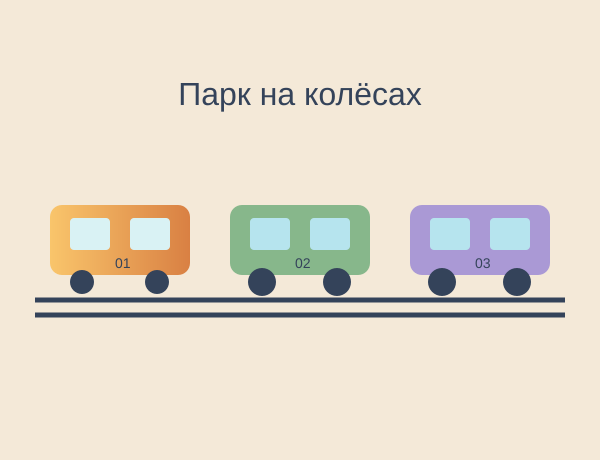
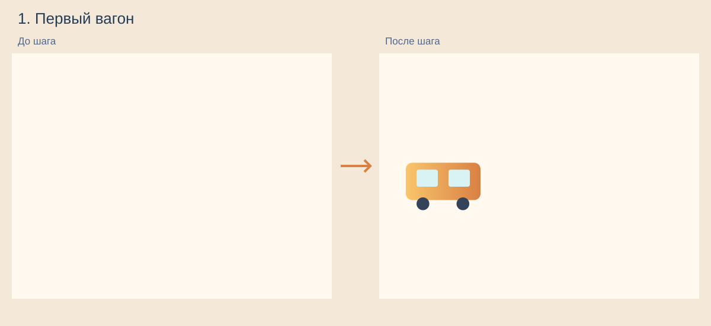
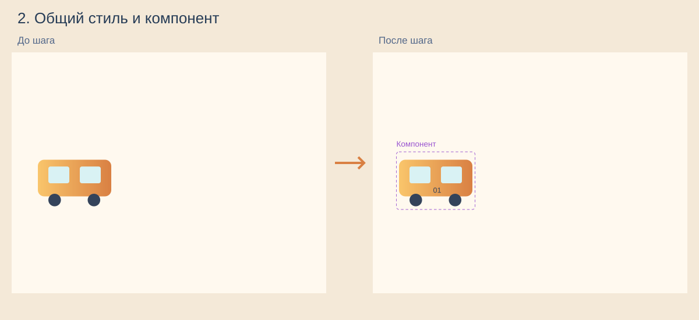
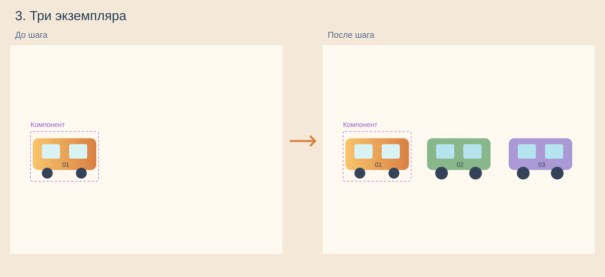
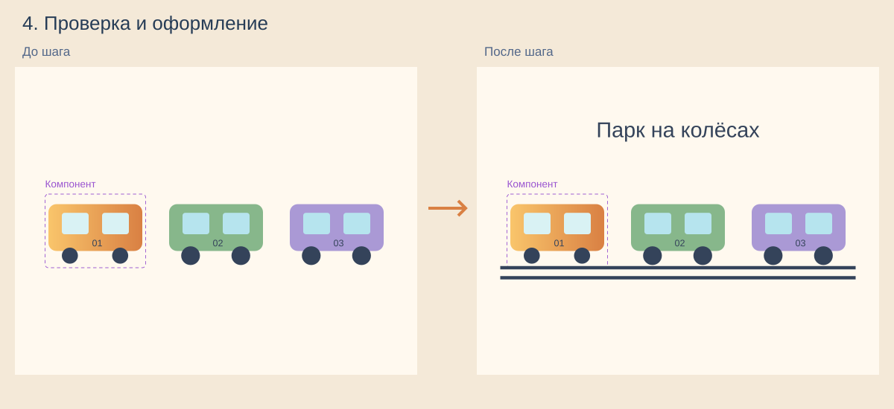

# Конструктор вагонов

Дополнительная работа к уроку 3 · средний уровень

Собери маленький поезд для парка развлечений. Вагоны будут экземплярами одного компонента, а их цвет и надписи можно менять. Так удобно оформлять целую серию объектов.

## Перед началом

Открой Figma и создай новый Design file. Назови его «Конструктор вагонов». Все размеры ниже указаны в пикселях. X и Y отсчитываются от верхнего левого угла родительского фрейма. Чтобы ввести точные размеры, выдели объект и найди поля W и H в правой панели Design. Цвет вводится в Fill. Не импортируй готовый рисунок вместо своей работы: он нужен для сравнения.

## Как выполнить

### Шаг 1. Первый вагон

Создай фрейм 600 × 460, фон #F4E9D8.

В стороне создай фрейм 150 × 110 с названием Вагон. Внутри нарисуй корпус X5 Y15 W140 H70, радиус 12, заливка Linear от #F9C56B сверху к #D98043 снизу. Добавь два окна 40 × 32 на X25 и X85, Y28, цвет #D9F2F4. Колёса — два круга 24 × 24 на X25 и X100, Y80, цвет #34435A.

### Шаг 2. Общий стиль и компонент

Выдели одно окно.

В Fill открой меню стилей (значок с четырьмя точками), создай стиль Стекло. Примени его ко второму окну через то же меню. Добавь текст T с номером 01 на корпус. Выдели весь фрейм Вагон и выбери Create component через контекстное меню. Главный компонент оставь вне итогового фрейма.

### Шаг 3. Три экземпляра

Открой Assets, перетащи компонент трижды в итоговый фрейм.

Размести экземпляры на X45, 225, 405 и Y190. В каждом выбери текстовый слой и измени номер на 01, 02, 03. Выбери корпус внутри второго и третьего экземпляров, поменяй заливку на зелёный и сиреневый градиенты. Не отсоединяй экземпляры.

### Шаг 4. Проверка и оформление

В главном компоненте измени размер обоих колёс с 24 до 28, сохрани их центры.

Проверь, что все три вагона обновились. Измени стиль Стекло на #B6E4EE: окна должны поменять цвет. В итоговом фрейме нарисуй рельсы двумя прямоугольниками и добавь заголовок. Экспортируй только итоговый фрейм.

## Основные настройки

| Параметр | Значение |
|---|---|
| Фрейм результата | 600 × 460 |
| Количество экземпляров | 3 |
| Заливка | Linear; общий стиль цвета |

## Если что-то не получается

Если изменение не передаётся копиям, проверь, что они взяты из Assets и не отсоединены. Если цвет не обновляется, возможно, ты назначил обычную заливку вместо стиля или переопределил её в экземпляре. Верни нужное свойство через Reset overrides, учитывая, что сброс может убрать твои изменения.

## Проверь работу

- [ ] Есть главный компонент и три связанных экземпляра.
- [ ] Номера различаются, изменение колёс передаётся всем экземплярам.
- [ ] Слои названы понятно, рисунок не обрезан случайно.

## Если хочется усложнить

Добавь вариант компонента «Ночной» с тёмными окнами и светлой полосой. Переключи один экземпляр через свойство варианта.

## Что сдать

Ссылку на редактируемый файл Figma и PNG готовой работы.
