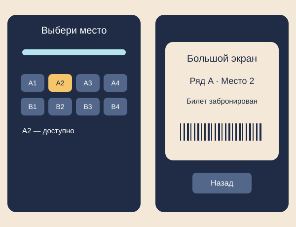
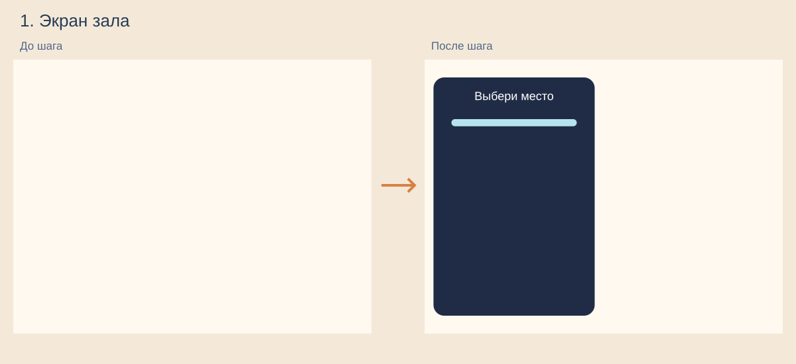
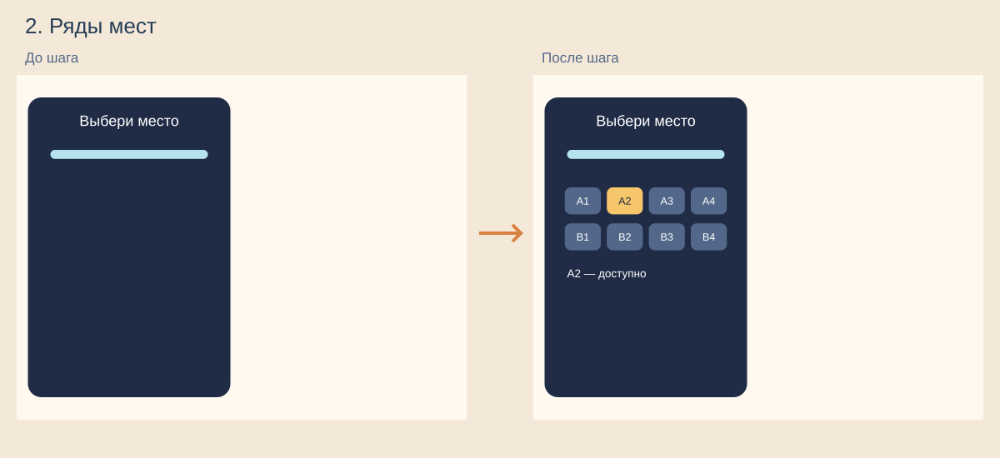
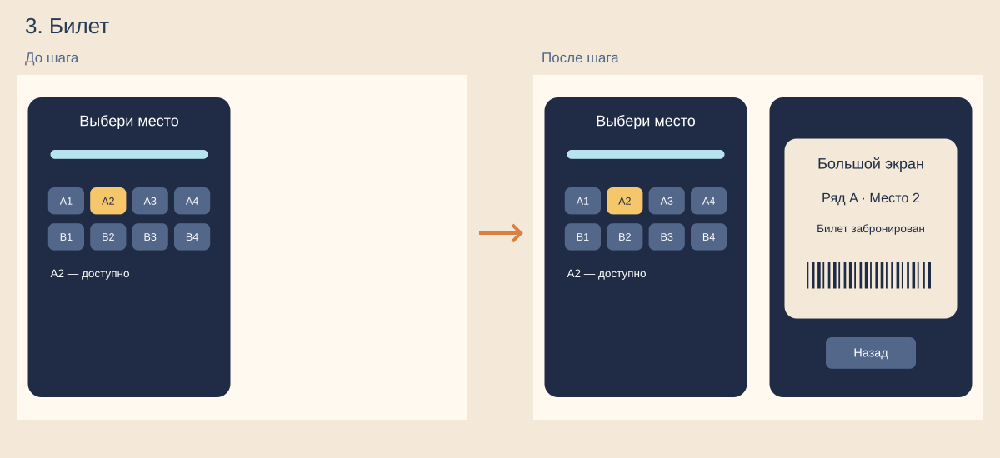
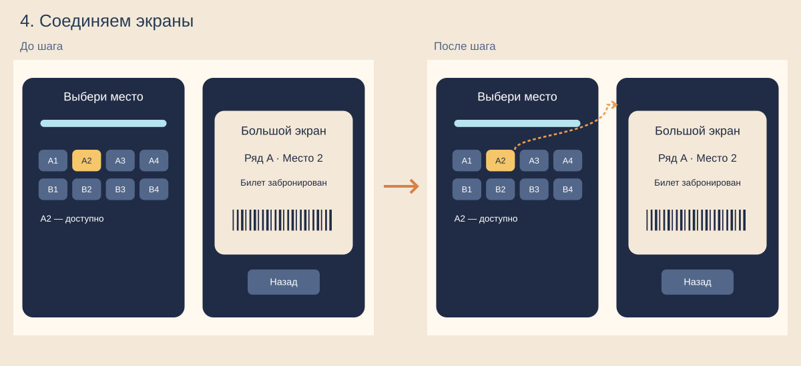

# Касса кинотеатра

Дополнительная работа к уроку 4 · повышенный уровень

Сделай прототип покупки билета в вымышленный кинотеатр. Посетитель выбирает место на схеме зала и видит билет. Никакой настоящей оплаты или ввода личных данных не нужно.

## Перед началом

Открой Figma и создай новый Design file. Назови его «Касса кинотеатра». Все размеры ниже указаны в пикселях. X и Y отсчитываются от верхнего левого угла родительского фрейма. Чтобы ввести точные размеры, выдели объект и найди поля W и H в правой панели Design. Цвет вводится в Fill. Не импортируй готовый рисунок вместо своей работы: он нужен для сравнения.

## Как выполнить

### Шаг 1. Экран зала

Создай фрейм 300 × 400 с фоном #202C46.

Добавь заголовок «Выбери место» (T, 22, белый), прямоугольник экрана X35 Y70 W230 H12, цвет #B6E4EE. Сделай одно место: текст A1 размером 14, выдели текст и нажми Shift+A. Padding 10 по горизонтали и 8 по вертикали, радиус 8, Fill #526789. Ширина Fixed 48, высота Fixed 36, выравнивание по центру.

### Шаг 2. Ряды мест

Преврати место в компонент, оставь главный отдельно.

Вставь четыре экземпляра из Assets, подпиши A1–A4. Выдели четыре экземпляра и нажми Shift+A, направление Horizontal, gap 8. Скопируй ряд, подпиши B1–B4. Выдели оба ряда, Shift+A, направление Vertical, gap 12. Поставь список на X42 Y120. Для A2 измени фон на #F5C66A и текст на #202C46. Под схемой добавь пояснение «A2 — доступно». Остальные места в этом прототипе не активны.

### Шаг 3. Билет

Рядом создай второй фрейм 300 × 400, фон #202C46.

Внутри прямоугольник X25 Y55 W250 H240, радиус 16, цвет #F4E9D8. Добавь название фильма «Большой экран», подписи «Ряд A», «Место 2», «Билет забронирован». Нарисуй штрихкод из узких прямоугольников. Под билетом создай кнопку «Назад» через Shift+A, padding 12 и 18, Fill #526789. Это учебный макет, штрихкод декоративный.

### Шаг 4. Соединяем экраны

Выдели экземпляр A2 на первом экране.

В Prototype потяни синюю ручку к фрейму билета. Interaction: On click → Navigate to → Билет, Animation Instant. Для кнопки Назад сделай On click → Navigate to → Зал. Выбери первый фрейм, запусти Present. Нажми A2, проверь номер места и вернись назад. Если нажимаются все места, проверь, что связь назначена экземпляру A2, а не главному компоненту.

## Основные настройки

| Параметр | Значение |
|---|---|
| Размер экрана | 300 × 400 |
| Количество экранов | 2 |
| Переход | On click → Navigate to |

## Если что-то не получается

Если кнопка не подстраивается под текст, выдели внешний Auto layout, а не надпись, и проверь Hug contents. Если переход не работает, открой Prototype и проверь источник и цель связи. Запускай Present с первого экрана.

## Проверь работу

- [ ] Два экрана, места собраны через Auto layout.
- [ ] A2 открывает билет с тем же номером, Назад возвращает к залу.
- [ ] Слои названы понятно, рисунок не обрезан случайно.

## Если хочется усложнить

Добавь отдельный билет для B3 и свяжи именно это место с новым экраном.

## Что сдать

Ссылку на редактируемый файл Figma и PNG готовой работы. Покажи преподавателю работающий прототип и оба экрана.
