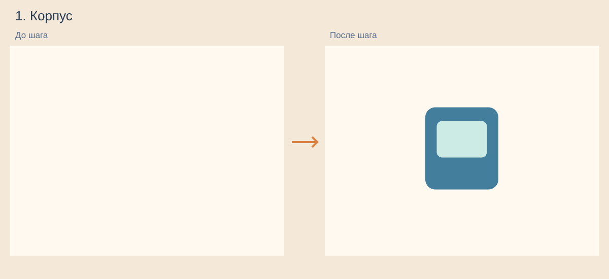
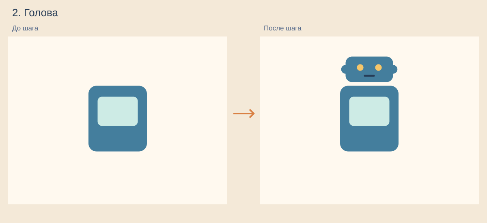
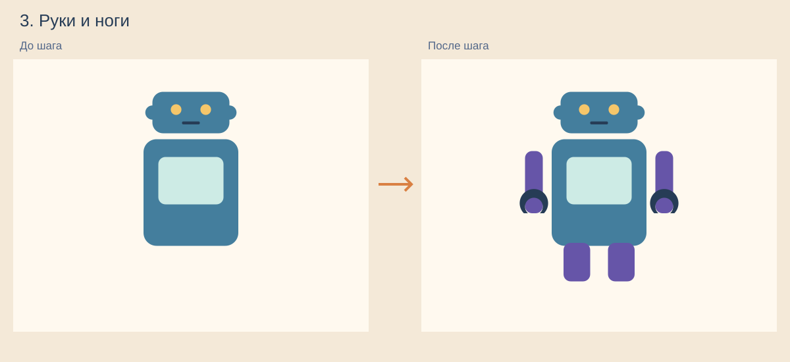
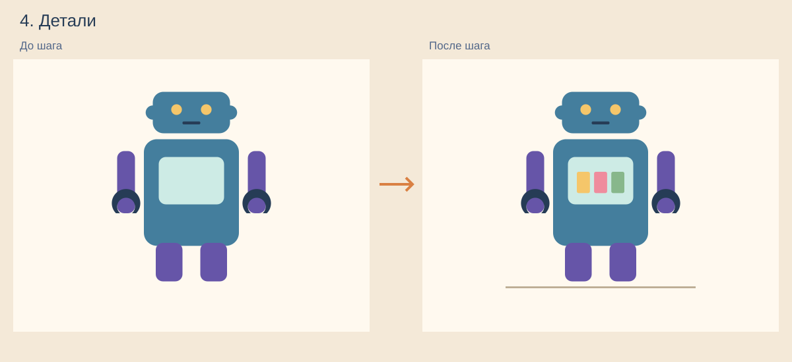

# Робот-сортировщик

Дополнительная работа к уроку 1 · начальный уровень

Нарисуй робота, который сортирует детали на заводе. У него прозрачная грудная панель и две механические руки.

## Перед началом

Открой Figma и создай новый Design file. Назови его «Робот-сортировщик». Все размеры ниже указаны в пикселях. X и Y отсчитываются от верхнего левого угла родительского фрейма. Чтобы ввести точные размеры, выдели объект и найди поля W и H в правой панели Design. Цвет вводится в Fill. Не импортируй готовый рисунок вместо своей работы: он нужен для сравнения.

## Как выполнить

### Шаг 1. Корпус

Фрейм 600 × 460, фон #F4E9D8.

R: корпус X220 Y135 W160 H180, радиус 22, цвет #447E9D. Поверх него прямоугольник X245 Y165 W110 H80, радиус 12. Выдели оба и выполни Subtract. Под отверстие поставь прямоугольник того же размера цвета #CDEBE5.

### Шаг 2. Голова

Собери голову из прямоугольника X235 Y55 W130 H70 с радиусом 18 и двух кругов 24 × 24 по бокам.

Объедини их через Union. Добавь два глаза 18 × 18 и полоску рта.

### Шаг 3. Руки и ноги

Нарисуй две руки из прямоугольников 30 × 105 с радиусом 12.

Поставь их по сторонам корпуса. Для каждого захвата вычти из круга 48 × 48 круг 30 × 30, смещённый вниз на 15. Получится раскрытая клешня. Добавь две ноги 45 × 65.

### Шаг 4. Детали

Внутри окна расположи три цветных прямоугольника 22 × 36.

Под роботом добавь линию пола. Назови группы Голова, Корпус, Руки, Ноги. Экспортируй PNG.

## Основные настройки

| Параметр | Значение |
|---|---|
| Фрейм | 600 × 460 |
| Основной инструмент | Rectangle (R), Ellipse (O) |
| Операции | Union, Subtract |

## Если что-то не получается

Если вычитание не сработало, проверь порядок слоёв: фигура, которая вырезает отверстие, должна лежать выше основы. Раскрой булеву группу в Layers, чтобы поправить исходные фигуры. Если объект оказался за фреймом, перетащи его внутрь фрейма в Layers.

## Проверь работу

- [ ] Отверстие и клешни сделаны вычитанием.
- [ ] Робот состоит из редактируемых фигур.
- [ ] Слои названы понятно, рисунок не обрезан случайно.

## Если хочется усложнить

Сделай сменный захват другой формы.

## Что сдать

Ссылку на редактируемый файл Figma и PNG готовой работы.
