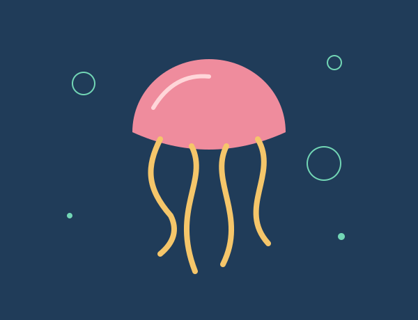
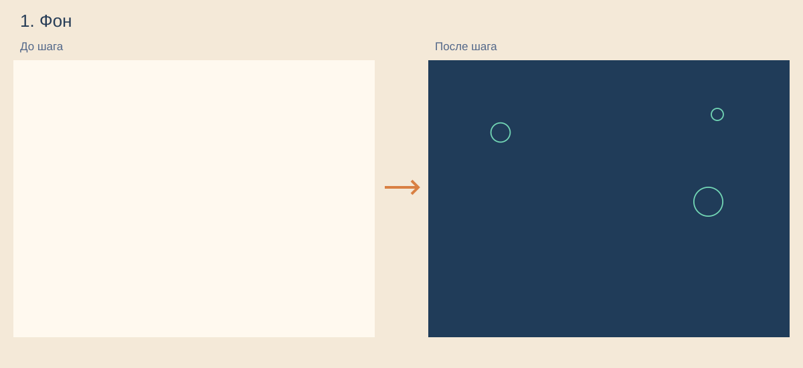
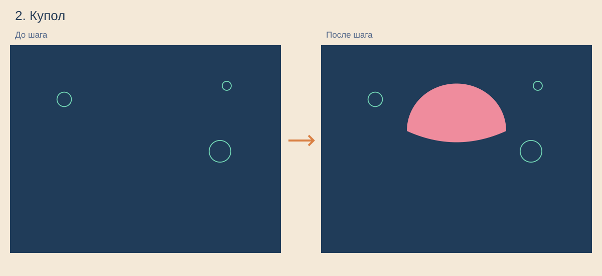
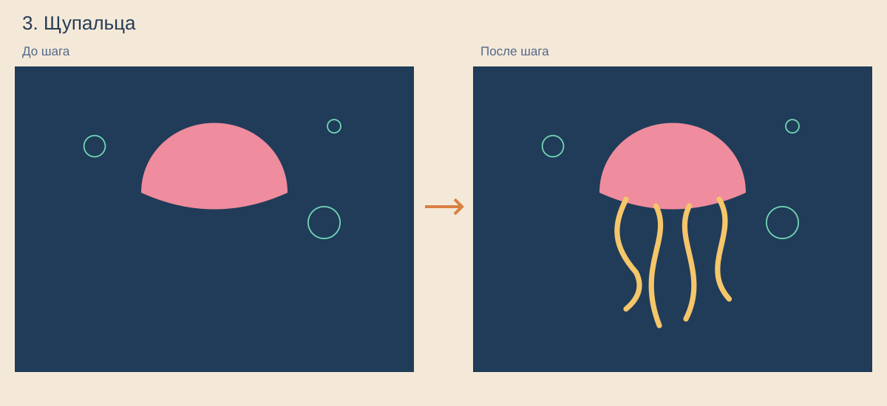
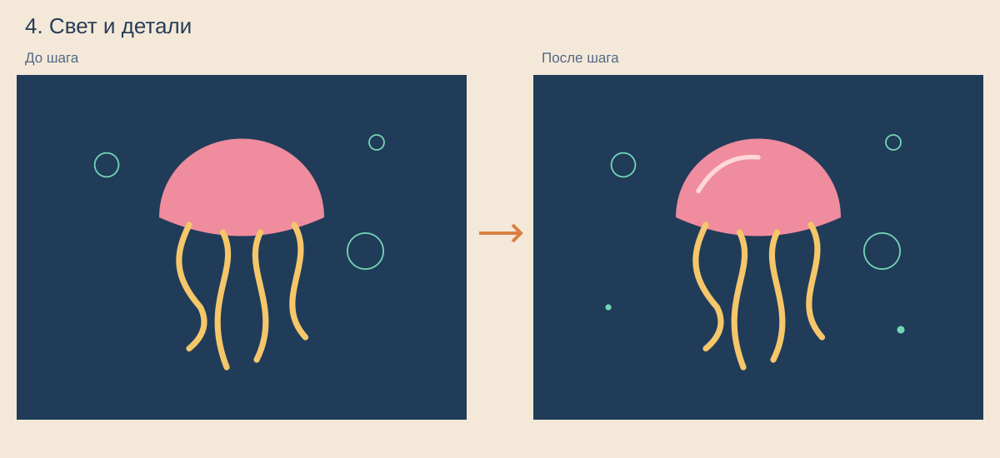

# Медуза в аквариуме

Дополнительная работа к уроку 2 · средний уровень

Создай подводную иллюстрацию с медузой. Плавные щупальца помогут разобраться, как направление усов влияет на линию.

## Перед началом

Открой Figma и создай новый Design file. Назови его «Медуза в аквариуме». Все размеры ниже указаны в пикселях. X и Y отсчитываются от верхнего левого угла родительского фрейма. Чтобы ввести точные размеры, выдели объект и найди поля W и H в правой панели Design. Цвет вводится в Fill. Не импортируй готовый рисунок вместо своей работы: он нужен для сравнения.

## Как выполнить

### Шаг 1. Фон

Создай фрейм 600 × 460, Fill #203C59.

Добавь три круга с обводкой #72D6B5 толщиной 2, без заливки. Это пузырьки; оставь середину свободной.

### Шаг 2. Купол

Пером поставь точки (190,190), (300,85) с протяжкой вправо, (410,190), (300,215) с протяжкой влево.

Замкни контур. Fill #EF8C9D. Если купол получился угловатым, дважды кликни и поправь усы верхней точки.

### Шаг 3. Щупальца

Пером нарисуй открытую линию: (230,200), (215,255) с протяжкой вниз, (245,310) с протяжкой вниз, (230,365).

Esc. Убери Fill, Stroke #F5C66A 8, окончания Round. Повтори с другими X, чтобы получилось четыре линии. Не делай их одинаковыми: меняй изгибы в режиме редактирования.

### Шаг 4. Свет и детали

Нарисуй короткую дугу внутри купола с обводкой #FFD6D9 6.

Добавь маленькие круги на фоне. Проверь, что линии щупалец не соединены случайно с куполом. Экспортируй PNG.

## Основные настройки

| Параметр | Значение |
|---|---|
| Фрейм | 600 × 460 |
| Перо | P |
| Окончания обводки | Round |

## Если что-то не получается

Если вместо плавной линии получился угол, проверь, что в нужной точке ты протянул мышь, а не просто кликнул. В режиме редактирования выдели точку и потяни её направляющую. Для открытой линии используй Stroke, для замкнутой фигуры — Fill. Не добавляй точки только ради исправления небольшого изгиба.

## Проверь работу

- [ ] Купол замкнут, щупальца открыты.
- [ ] Есть минимум четыре плавные линии с разными изгибами.
- [ ] Слои названы понятно, рисунок не обрезан случайно.

## Если хочется усложнить

Сделай вторую медузу меньшего размера, отрази её по горизонтали.

## Что сдать

Ссылку на редактируемый файл Figma и PNG готовой работы.
