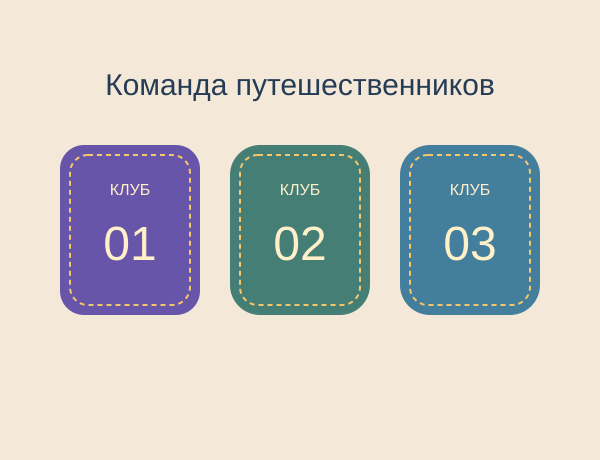
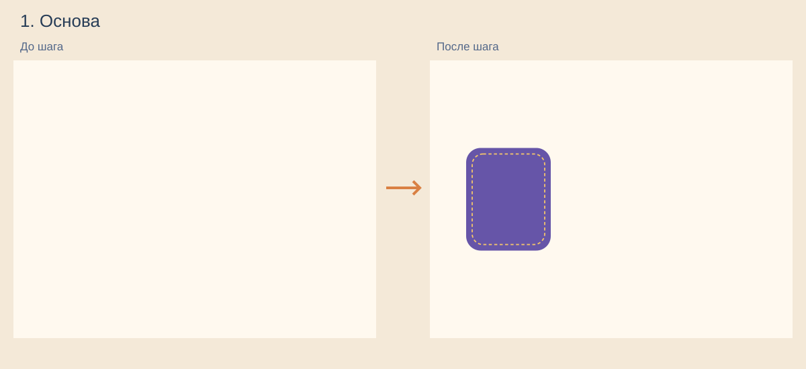
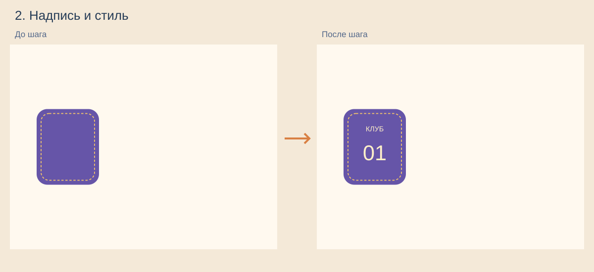
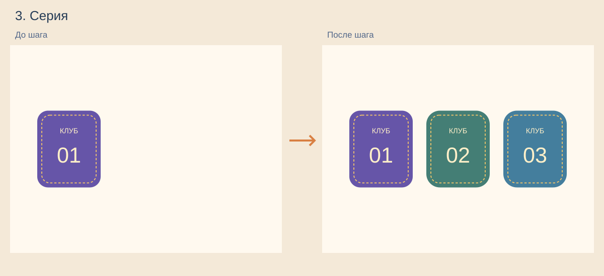
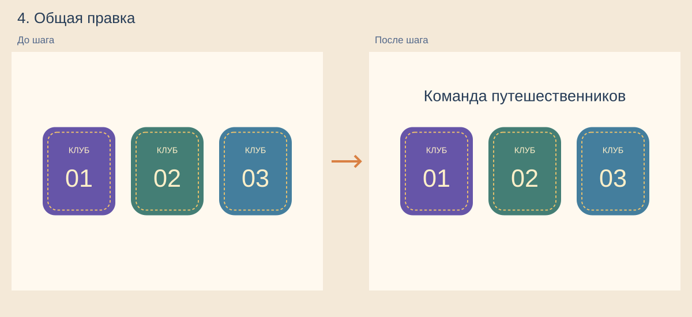

# Нашивки для рюкзака

Дополнительная работа к уроку 3 · средний уровень

Сделай серию тканевых нашивок для школьного клуба путешественников. Они будут одинаковой формы, но с разными номерами и цветами. Это не логотип: на каждой нашивке есть декоративная строчка и номер участника.

## Перед началом

Открой Figma и создай новый Design file. Назови его «Нашивки для рюкзака». Все размеры ниже указаны в пикселях. X и Y отсчитываются от верхнего левого угла родительского фрейма. Чтобы ввести точные размеры, выдели объект и найди поля W и H в правой панели Design. Цвет вводится в Fill. Не импортируй готовый рисунок вместо своей работы: он нужен для сравнения.

## Как выполнить

### Шаг 1. Основа

Создай фрейм 600 × 460, фон #F4E9D8.

В стороне создай фрейм 140 × 170. Нарисуй прямоугольник 140 × 170, радиус 24, Linear от #6655A8 к #413875. Внутри прямоугольник X10 Y10 W120 H150, радиус 18, без Fill, Stroke #F5C66A 2. В расширенных настройках Stroke задай Dash 5, Gap 4.

### Шаг 2. Надпись и стиль

Добавь текст «КЛУБ» размером 16 и номер 01 размером 48, белый.

Сохрани цвет текста как стиль Надпись и примени к обоим слоям. Выдели фрейм и создай компонент.

### Шаг 3. Серия

Из Assets вставь три экземпляра в основной фрейм на X60,230,400 и Y145.

Поменяй номера на 01, 02, 03. В двух экземплярах измени заливку основы на зелёный и синий градиенты. Не удаляй связь с главным компонентом.

### Шаг 4. Общая правка

В главном компоненте измени радиус внешнего прямоугольника с 24 до 30.

Проверь все экземпляры. Измени стиль Надпись на #FFF0C9. Добавь заголовок над серией и экспортируй PNG.

## Основные настройки

| Параметр | Значение |
|---|---|
| Фрейм результата | 600 × 460 |
| Количество экземпляров | 3 |
| Заливка | Linear; общий стиль цвета |

## Если что-то не получается

Если изменение не передаётся копиям, проверь, что они взяты из Assets и не отсоединены. Если цвет не обновляется, возможно, ты назначил обычную заливку вместо стиля или переопределил её в экземпляре. Верни нужное свойство через Reset overrides, учитывая, что сброс может убрать твои изменения.

## Проверь работу

- [ ] Три экземпляра одного компонента.
- [ ] Общая строчка и стиль надписей, разные номера.
- [ ] Слои названы понятно, рисунок не обрезан случайно.

## Если хочется усложнить

Создай вариант нашивки с подписью «Капитан» и проверь переключение.

## Что сдать

Ссылку на редактируемый файл Figma и PNG готовой работы.
