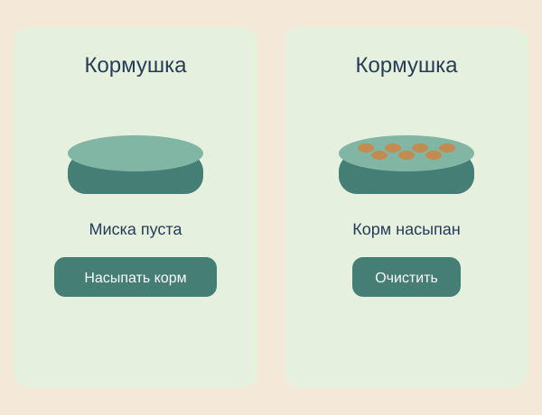
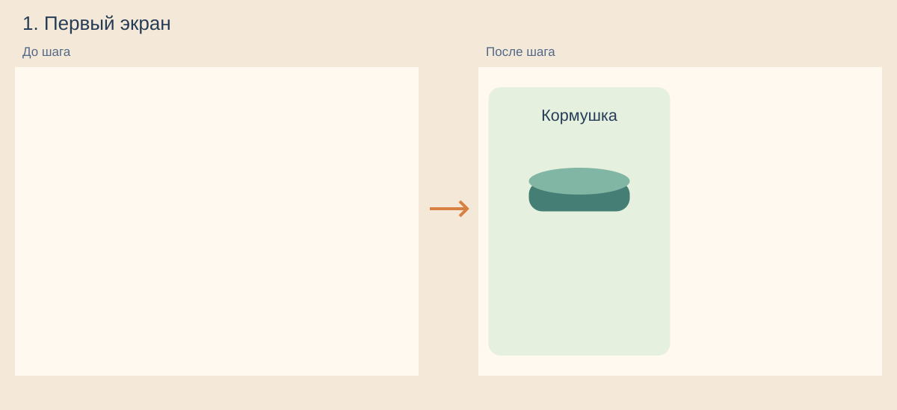
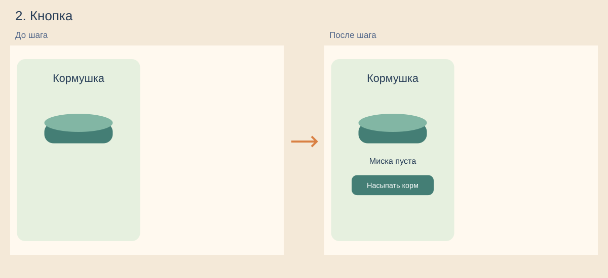
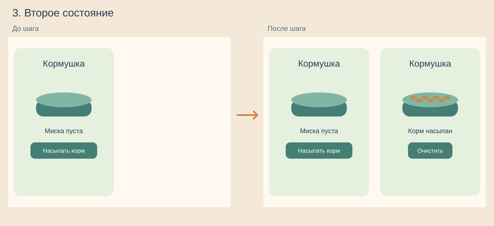
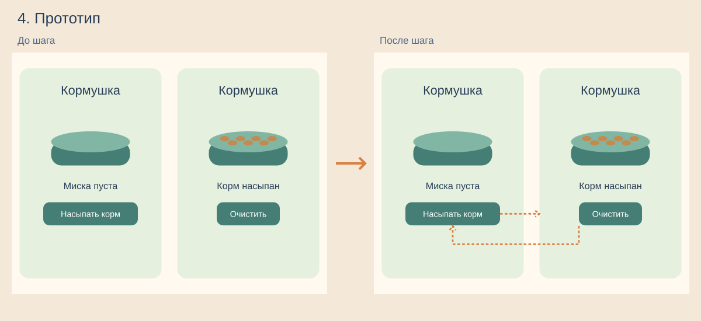

# Пульт кормушки для птиц

Дополнительная работа к уроку 4 · повышенный уровень

Придумай экран управления автоматической кормушкой. В учебном прототипе кнопка меняет экран с пустой миской на экран с кормом. Настоящим устройством макет не управляет.

## Перед началом

Открой Figma и создай новый Design file. Назови его «Пульт кормушки для птиц». Все размеры ниже указаны в пикселях. X и Y отсчитываются от верхнего левого угла родительского фрейма. Чтобы ввести точные размеры, выдели объект и найди поля W и H в правой панели Design. Цвет вводится в Fill. Не импортируй готовый рисунок вместо своей работы: он нужен для сравнения.

## Как выполнить

### Шаг 1. Первый экран

Создай фрейм 280 × 400, Fill #E6F0DF.

Заголовок «Кормушка» размером 24, цвет #263C56. Нарисуй миску: эллипс 150 × 40 и прямоугольник 150 × 45 с радиусом 20, цвет #447E75. Поставь в центре экрана. Под ней текст «Миска пуста».

### Шаг 2. Кнопка

Создай текст «Насыпать корм» размером 16.

Shift+A, padding 16 по бокам, 12 сверху и снизу, Hug по обеим осям, Fill #447E75, текст белый, радиус 12. Выдели подпись состояния и кнопку, Shift+A, Vertical, gap 16, выравнивание по центру. Размести под миской.

### Шаг 3. Второе состояние

Дублируй весь фрейм Ctrl+D (Cmd+D на Mac).

Назови Корм насыпан. Добавь в миску семь маленьких эллипсов цвета #C28B50. Измени подпись на «Корм насыпан», кнопку на «Очистить». Благодаря Hug фон кнопки изменит ширину сам.

### Шаг 4. Прототип

В Prototype свяжи кнопку первого фрейма со вторым: On click → Navigate to → Корм насыпан.

На втором экране свяжи кнопку с первым. Запусти Present с первого экрана и пройди цикл дважды. Проверь, что кнопка не обрезает текст.

## Основные настройки

| Параметр | Значение |
|---|---|
| Размер экрана | 280 × 400 |
| Количество экранов | 2 |
| Переход | On click → Navigate to |

## Если что-то не получается

Если кнопка не подстраивается под текст, выдели внешний Auto layout, а не надпись, и проверь Hug contents. Если переход не работает, открой Prototype и проверь источник и цель связи. Запускай Present с первого экрана.

## Проверь работу

- [ ] Два состояния с разным содержимым миски.
- [ ] Кнопки с Auto layout и работающий переход в обе стороны.
- [ ] Слои названы понятно, рисунок не обрезан случайно.

## Если хочется усложнить

Добавь третий экран «Запас корма закончился» и кнопку возврата.

## Что сдать

Ссылку на редактируемый файл Figma и PNG готовой работы. Покажи преподавателю работающий прототип и оба экрана.
