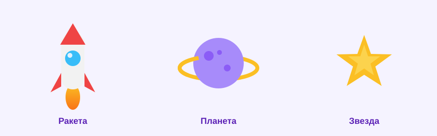
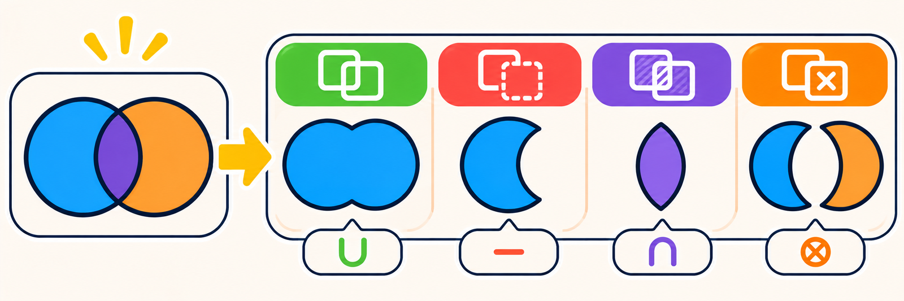
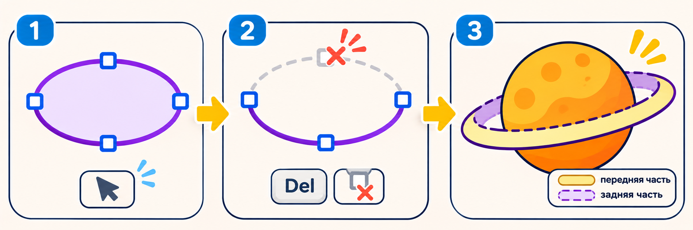

# Как сделать набор иконок в Figma — шпаргалка с картинками

> Твоя пошаговая подсказка на урок. Собираем три иконки в одном стиле: ракета, планета, звезда. Отмечай галочки по мере готовности.

**К чему идём:**

**Что понадобится:** только браузер и **Figma** (figma.com, вход по почте). Ничего скачивать не нужно.

---

## Сначала пойми главное

Вектор — это картинка не из пикселей, а из **точек и кривых**. Поэтому она чёткая на любом размере: хоть на кнопке, хоть на целой стене.

Любая фигура собрана из **опорных точек** — узелков по краям. У прямоугольника они по углам, у круга — по бокам. Их можно двигать и удалять (это пригодится для кольца планеты).

---

## Фаза 1. Три листа-фрейма

- [ ] Открой Figma, нажми **«+ Design file»**.
- [ ] Возьми инструмент **«Фрейм»** (клавиша **F**), задай размер **512 × 512**, кликни на холсте.
- [ ] Сделай так три фрейма. Назови их (двойной клик по названию слева): **ракета**, **планета**, **звезда**.

Важно: все детали рисуем **внутри фрейма**, а не на сером поле вокруг.

---

## Фаза 2. Ракета

Рисуем во фрейме «ракета». Ракета — это простые фигуры, сложенные вместе.

- [ ] **Корпус:** инструмент **«Прямоугольник»** (**R**), нарисуй вертикальный прямоугольник ~160 × 280. Справа в поле **«Скругление углов»** поставь **80** — выйдет капсула. Залей светлым **#F2F2F2**.
- [ ] **Нос:** **«Многоугольник»** (это треугольник), ~160 × 120, острым концом вверх, на верхушку. Залей красным **#EF4444**.
- [ ] **Плавники:** маленький треугольник ~70 × 100 слева внизу, наклони. Скопируй (**Ctrl+C**, **Ctrl+V**), отрази по горизонтали (правый клик → «Отразить по горизонтали»), поставь справа. Залей красным.

**Склеиваем ракету.** Выдели корпус, нос и оба плавника (рамкой или с зажатым **Shift**). Сверху по центру нажми **булевы операции** → **Объединение**. Фигуры сольются в один силуэт.

- [ ] **Окно:** **«Эллипс»** (**O**), круг ~90 × 90 по центру верха. Залей голубым **#38BDF8**. Сверху — маленький белый круг-блик. (Посложнее: выдели ракету и круг → **Вычитание** — будет настоящая дырка.)
- [ ] **Огонь:** эллипс или треугольник остриём вниз под ракетой, залей градиентом оранжевый → жёлтый. В слоях поставь его **ниже** ракеты.
- [ ] Выдели всё → **Ctrl+G** (группа), назови «ракета».

---

## Фаза 3. Планета

Рисуем во фрейме «планета». Здесь два приёма: кратеры Вычитанием и кольцо через опорную точку.

- [ ] **Шар:** **«Эллипс»** (**O**), с зажатым **Shift** нарисуй ровный круг ~240 × 240. Залей фиолетовым **#A78BFA** (можно радиальным градиентом для объёма).
- [ ] **Кратеры:** нарисуй поверх шара 2–3 маленьких кружка (~30–50). Выдели их **вместе с шаром** → **Вычитание**. На месте кружков появятся вмятины.

**Кольцо вокруг планеты.** Делаем в два слоя, чтобы кольцо проходило и за планетой, и перед ней.

- [ ] Нарисуй широкий плоский овал ~360 × 110. Убери заливку, задай **обводку** жёлтую **#FBBF24**, толщина 10–14. Слегка наклони и совмести с центром планеты.
- [ ] **Задняя часть:** в слоях перетащи овал **ниже** шара. Теперь он виден только по бокам.
- [ ] **Передняя часть:** продублируй овал (**Ctrl+D**). Дважды кликни по копии (войдёшь в редактирование, появятся 4 точки). Кликни по **верхней** точке → **Delete**. Останется нижняя дуга. Нажми **Esc**.
- [ ] Перетащи эту дугу в слоях **выше** шара. Теперь кольцо обнимает планету.

Если удалил не ту точку — **Ctrl+Z** и попробуй снова верхнюю.

---

## Фаза 4. Звезда

Рисуем во фрейме «звезда».

- [ ] Инструмент **«Звезда»**, нарисуй ~220 × 220. Справа поставь **число лучей = 5** и настрой остроту (**Ratio**). Залей жёлтым **#FBBF24**.
- [ ] Рядом добавь маленький белый блик-звёздочку для искры.

---

## Фаза 5. Экспорт

- [ ] Кликни **фрейм** целиком (по названию в слоях).
- [ ] Справа внизу — **«Экспорт»** → **+**.
- [ ] Выбери формат: **PNG** (×2 или ×3) для картинки или **SVG** для настоящего вектора.
- [ ] Нажми **«Export …»**, выбери папку.

---

## Проверь себя

- [ ] Три иконки в одном стиле (похожие цвета и скругления);
- [ ] Ракета собрана **Объединением**;
- [ ] Окно и кратеры — **Вычитанием** (или кружком сверху, если проще);
- [ ] Кольцо планеты обнимает её (передняя дуга через удаление точки);
- [ ] Всё нарисовано **внутри фреймов**, слои названы;
- [ ] Набор экспортирован в PNG и SVG.

Получилось? Дальше — своя тема в [практике](практика.md).
