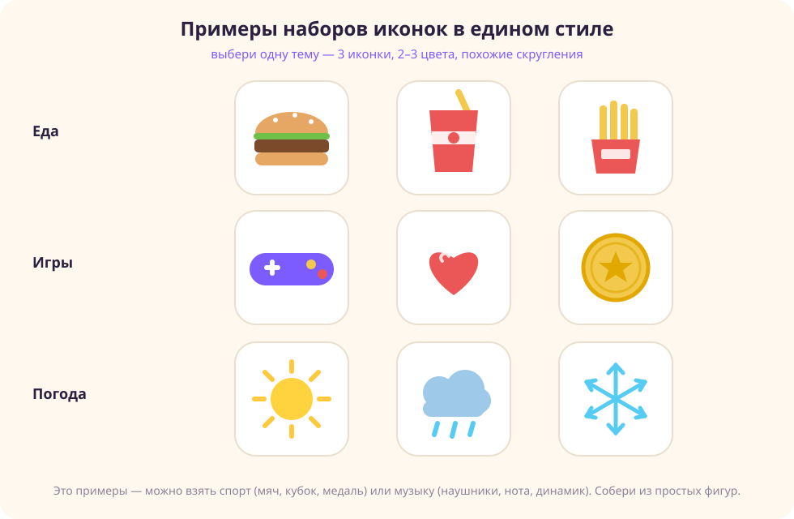
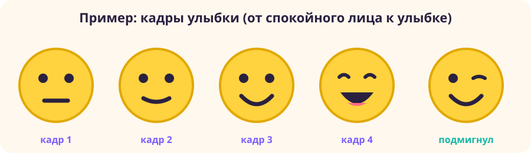

# Самостоятельная работа — Векторная графика, Урок 1

> Космос мы уже собрали на уроке. Здесь делаешь **свой** набор иконок на другую тему и закрепляешь булевы операции, а в конце — оживляешь рисунок анимацией.
>
> Забыл, как что делается? Загляни в [шпаргалку с картинками](как-сделать-иконки.md) — там все шаги по фигурам, булевым операциям и кольцу планеты.

---

## Задание 1 — «Свой набор иконок»

Сделай набор из трёх иконок в едином стиле на **другую** тему (не космос). Выбери одну:

- **Еда:** гамбургер, стакан колы, картошка фри;
- **Игры:** джойстик, сердечко-жизнь, монетка;
- **Погода:** солнце, туча с дождём, снежинка;
- **Спорт:** мяч, кубок, медаль;
- **Музыка:** наушники, нота, динамик.

Вот как такие наборы могут выглядеть — обрати внимание, что внутри каждой темы всего два-три цвета и похожие скругления:

Обязательные условия (чтобы было по-настоящему):
- [ ] Каждая иконка собрана **из простых фигур**, а не нарисована от руки;
- [ ] Использована хотя бы одна **булева операция** (Объединение или Вычитание);
- [ ] **Единый стиль:** одна палитра из двух-трёх цветов и похожие скругления;
- [ ] Каждая иконка — в своём фрейме, слои названы;
- [ ] Экспорт в **PNG и SVG**.

---

## Задание 2 (комбо, Photoshop и вектор) — «Иконка-плитка»

Свяжи новое со старым:
1. В Figma возьми одну свою иконку из Задания 1.
2. Сделай под неё фон-подложку: круг или скруглённый квадрат (как «плитка приложения») с градиентом.
3. Поставь иконку по центру, выровняй и экспортируй в PNG.
4. Открой PNG в Photoshop и добавь мягкую тень (как в модуле 2) — выйдет объёмная иконка-кнопка.

**Результат:** готовая иконка-плитка, как в магазине приложений.

---

## Задание 3 — «Оживи рисунок»: от фигур к анимации

Это связка сразу трёх умений: **фигуры** и **булевы операции** из этого урока плюс **GIF-анимация** из урока 15 модуля 2. Сначала рисуешь героя из фигур в Figma, потом оживляешь его в Photoshop.

**Шаг 1. Нарисуй смайлик из фигур (в Figma).**
Большой жёлтый круг — это лицо. Два маленьких тёмных круга — глаза. Улыбка — дуга: можно нарисовать её пером, а можно хитро через **Вычитание** — возьми два круга, наложи меньший на больший со смещением вверх и вычти его; от большого останется «полумесяц»-улыбка.

**Шаг 2. Сделай несколько кадров — разные выражения лица.**
Скопируй смайлик 3–5 раз и в каждой копии поменяй лицо: спокойное → лёгкая улыбка → широкая улыбка → смех → подмигнул. Меняй только рот и глаза, остальное оставляй на месте — тогда в анимации лицо будет «оживать», а не прыгать.

Вот так может выглядеть набор кадров:

**Шаг 3. Экспортируй каждый кадр в PNG** (по одному файлу на кадр).

**Шаг 4. Собери анимацию в Photoshop.**
Открой кадры, сложи их слоями и собери GIF через Шкалу времени — как мы делали в уроке 15 («Создать анимацию кадра», тайминг под кадрами, зацикливание «Постоянно», экспорт в GIF). Получится живой смайлик, который улыбается или подмигивает.

### Можно не смайлик — выбери, что оживить

Смайлик — это пример. Приём один и тот же (нарисовал из фигур → наделал кадров с мелкими отличиями → собрал GIF), а герой может быть любым. Идеи:

- **Светофор:** три круга в прямоугольнике, по кадрам зажигается красный → жёлтый → зелёный.
- **Загрузка:** точки или сектора круга по очереди загораются (как колечко загрузки в приложениях).
- **Сердечко:** бьётся — в кадрах чуть больше и чуть меньше (пульс).
- **Звезда:** вращается или мигает лучами (меняй наклон и размер по кадрам).
- **Погода:** солнышко прячется за тучу, из тучи капают капли (двигай детали по кадрам).
- **Ракета** из урока: по кадрам пламя под ней то длиннее, то короче — будто дрожит огонь.
- **Глаз:** открывается и закрывается (моргает) — меняй высоту «века».
- **Стрелка-указатель:** прыгает вверх-вниз или перетекает слева направо.

Выбирай то, что нравится. Главное — чтобы между кадрами менялось немного: тогда движение выйдет плавным.

---

## Что проверяем

- [ ] Набор — **своя тема** (не урочный космос);
- [ ] Иконки собраны из фигур плюс **булева операция**;
- [ ] **Единый стиль:** палитра и скругления;
- [ ] Фреймы, названные слои;
- [ ] Экспорт PNG и SVG;
- [ ] Сделано комбо (иконка-плитка на фоне);
- [ ] Рисунок из фигур **ожил в анимации** (GIF из кадров).

## Для 5–7 классов

- Хватит двух иконок. Булеву операцию — хотя бы одну (Объединение). Палитру берём готовую.
- В Задании 3 достаточно трёх кадров (например, спокойное лицо → улыбка → широкая улыбка).

## Для 9–11 классов

- Четыре иконки плюс общая доска-обложка набора.
- Детали — через Вычитание (настоящие дырки), выравнивание по пиксельной сетке.
- Палитру подбери сам на [Coolors](https://coolors.co/).
- В Задании 3 сделай 5–6 кадров и добавь промежуточные кадры через Tween, чтобы движение стало совсем плавным.

## Галерея «Иконки класса»

Сдай набор — соберём общую доску иконок. Голосуем за самый ровный набор и самую оригинальную тему. Оживший GIF показываем отдельно.

## Что сдать

- Папка с `*.png` и `*.svg` набора (Задание 1) и иконка-плитка на фоне (Задание 2).
- GIF-анимация ожившего рисунка (Задание 3).
- Ссылку на Figma-файл — тоже.
