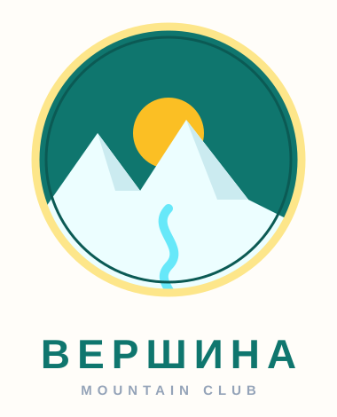
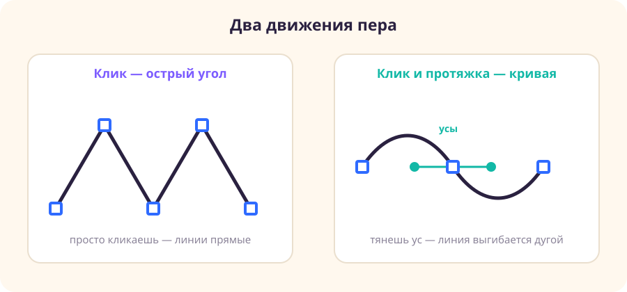

# Как нарисовать логотип пером — шпаргалка с картинками

> Твоя пошаговая подсказка на урок. Рисуем эмблему «ВЕРШИНА»: горы, солнце и реку в круглом бейдже. Отмечай галочки по мере готовности.

**К чему идём:**

**Что понадобится:** только браузер и **Figma** (figma.com).

---

## Главное про перо

У пера всего два движения:

- **Клик** — ставит точку, линия идёт **прямо** (острый угол). Так рисуют горы.
- **Клик и протяжка** (нажал и потянул) — у точки появляются **усы**, линия идёт **дугой**. Так рисуют реку.

Правило: **мало точек, длинные усы**. Дуга — это две точки, а не десять.

---

## Фаза 1. Разминка на черновике

- [ ] Сделай отдельный фрейм «черновик».
- [ ] Перо (**P**), нарисуй **треугольник** тремя кликами, замкни кликом по первой точке. `Enter`. Это углы.
- [ ] Нарисуй **волну**: ставь точки кликом с протяжкой. Это кривые. Почувствуй усы.

Можно обвести [трафарет разминки](../урок-06-ai-перо-логотип-маскот/трафареты/трафарет-разминка-пера.svg).

---

## Фаза 2. Основа бейджа

Фрейм «логотип» (**F**), размер **400 × 400**.

- [ ] **Круг-небо:** «Эллипс» (**O**) с **Shift**, ровный круг **320 × 320**. Залей тёмно-бирюзовым **#0F766E**.
- [ ] **Кольцо:** копия круга (**Ctrl+C**, **Ctrl+V**), чуть больше (**340 × 340**), убери заливку, включи **Обводку** золотую **#FDE68A**, толщина **8**. Выровняй по центру.
- [ ] **Солнце:** круг **120 × 120** амбер **#FBBF24** в верхней части бейджа.

---

## Фаза 3. Горы пером (клики)

- [ ] Перо (**P**). Начни слева от круга. Кликай зубцами (вниз-вверх-вниз), сделай 2–3 острых пика. Дойди до правого края.
- [ ] Спустись вниз и по нижней дуге вернись к старту, замкни контур (клик по первой точке). `Enter`.
- [ ] Залей горы почти-белым **#ECFEFF**.
- [ ] **Вписать в круг:** выдели горы и круг-небо, нажми булевы операции → **Пересечение (Intersect)**. Лишнее за кругом обрежется.

Пик горы — только **клик**. Если потянешь — выйдет «холмик».

---

## Фаза 4. Река пером (кривая)

- [ ] Перо (**P**). Поставь первую точку ниже гор, веди вниз **кликом с протяжкой**, чтобы линия извивалась (2–3 изгиба). Не замыкай, `Enter`.
- [ ] Убери заливку, включи **Обводку** голубую **#67E8F9**, толщина **10**, концы скруглённые («Round»).
- [ ] Не нравится изгиб — двойной клик по реке, потяни точку или её ус.

Река дёргается углами? Наведи на точку инструментом **«Изгиб»** и потяни — станет плавно.

---

## Фаза 5. Сборка и текст

- [ ] Проверь **порядок слоёв:** кольцо и небо снизу, солнце выше, горы над солнцем, река сверху.
- [ ] Текст (**T**): под бейджем впиши **ВЕРШИНА** жирным, широко.
- [ ] Выдели всё → **Ctrl+G**, назови «лого ВЕРШИНА».

---

## Фаза 6. Экспорт

- [ ] Выдели фрейм или группу лого.
- [ ] Справа внизу **«Экспорт»** → **+** → **SVG** (вектор) или **PNG ×2** (прозрачный фон).
- [ ] «Export …», выбери папку.

---

## Проверь себя

- [ ] Горы нарисованы **кликами** (острые пики);
- [ ] Река нарисована **протяжкой** (плавная, с усами);
- [ ] Контур гор **замкнут**, лишних точек нет;
- [ ] Горы **вписаны в круг** (Пересечение);
- [ ] Есть название и порядок слоёв;
- [ ] Логотип **читается маленьким** (уменьши до аватарки — узнаётся?);
- [ ] Экспорт в SVG и PNG.

Получилось? Дальше — свой логотип другой темы в [практике](практика.md).
