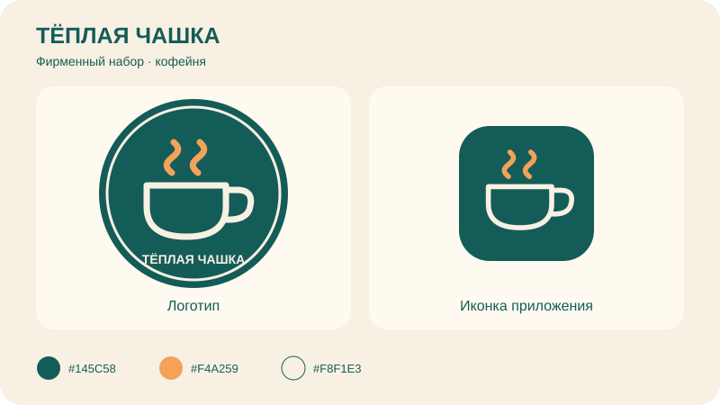

# Самостоятельная работа — Векторная графика, Урок 2

> «Вершину» мы уже нарисовали на уроке. Здесь рисуешь **свой** логотип-знак другой темы и набиваешь руку на пере.
>
> Забыл, как ставить точки и тянуть усы? Загляни в [шпаргалку с картинками](как-сделать-логотип.md).

---

## Разминка — тренажёр пера

Открой [The Bézier Game](https://bezier.method.ac/) и пройди обучающие фигуры: прямые отрезки, плавные кривые и замыкание контура. Следуй подсказкам игры; её сочетания клавиш могут отличаться от Figma. Не соревнуемся на скорость — важна точность.

Затем открой [трафарет](трафареты/трафарет-разминка-пера.svg). Повтори зубцы, горки и S-волну в Figma.

---

## Задание 1 (для всех) — «Свой логотип-знак»

Нарисуй логотип на **другую** тему (не горный клуб). В нём обязательно есть **кривая, нарисованная пером**. Выбери одну идею:

- **Кофейня** — чашка (пером) и пар (плавные кривые) в круглом бейдже;
- **Животное-бренд** — лиса, кот или сова: голова пером плюс фигуры;
- **Сёрф и море** — волна (кривая), солнце и доска;
- **Гейм-студия** — комета или молния (острые углы) и орбита (кривая);
- **Еда-бренд** — кусок пиццы или мороженое в бейдже.

💡 [Как сделать логотип — пошаговая инструкция с картинками](как-сделать-логотип.md). Используй её как подсказку, но выбери собственную тему.

Обязательные условия (чтобы было по-настоящему):
- [ ] Есть форма, **нарисованная пером** (не только готовые фигуры);
- [ ] Использованы и **острый угол** (клик), и **кривая** (клик с протяжкой);
- [ ] Контуры **замкнуты**, где нужно; лишних точек нет;
- [ ] Логотип **читается маленьким** (проверь на размере аватарки);
- [ ] Экспорт **SVG и PNG**.

---

## Задание 2 (комбо, уроки 1 и 2) — «Знак и иконка в наборе»

Свяжи с прошлым уроком:
1. Помести свой логотип и иконку из урока 1 на один фрейм-обложку.
2. Приведи их к единому стилю (одна палитра, похожая толщина линий) — как фирменный набор бренда.
3. Экспортируй обложку в PNG.

**Результат:** мини-фирменный стиль — логотип и иконка в одном духе.

На примере слева — логотип кофейни «Тёплая чашка», справа — простая иконка чашки. Оба используют бирюзовый, кремовый и оранжевый цвета, одинаковые скругления и толщину линий. Это ориентир, а не обязательная тема.

Создай фрейм 800 × 450 px, размести знак слева, иконку справа. Добавь название бренда и три образца цветов. Проверь, что иконка читается при уменьшении до 48 × 48 px.

---

## Задание 3 — «Мастерская кривых» (без ограничения времени)

Создай фрейм 600 × 400 px и нарисуй три небольших символа пером: сердечко, каплю и лист. Это тренировка сочетания острых углов и плавных дуг, а не гонка.

1. **Сердечко:** две округлые половинки сверху, острый угол снизу. Замкни контур и добавь заливку.
2. **Капля:** острый кончик сверху, округлый низ. Используй протяжку на боковых точках.
3. **Лист:** две плавные дуги, соединённые острыми кончиками. Добавь жилку открытой линией с обводкой.
4. Дважды кликни по каждой фигуре, проверь точки и исправь хотя бы один изгиб перемещением уса. Сравни до и после.

🧩 **Для 5–7:** сделай две фигуры, третью — по желанию. Можно подложить собственный эскиз.

🎓 **Для 9–11:** сделай все три, добавь вариант листа с асимметричной кривой, независимо изменив один ус.

**Что сдать:** фрейм с фигурами в PNG. Главное — чистые контуры, а не скорость.

---

## Что проверяем

- [ ] Логотип — **своя тема** (не урочная «Вершина»);
- [ ] Есть форма **пером**, с углом и кривой;
- [ ] Контуры замкнуты, лишних точек нет;
- [ ] Читается маленьким;
- [ ] Экспорт SVG и PNG;
- [ ] Сделано комбо (логотип и иконка в едином стиле).

## Для 5–7 классов
- Пером рисуем **одну** плавную деталь (пар, волну, хвост), остальное — из фигур. Тему берём попроще (солнце и волна).

## Для 9–11 классов
- Сделай **одноцветную** версию логотипа (силуэт-«штамп»).
- Нарисуй половину знака пером и **отрази** — симметричный логотип.
- Почисти узлы (минимум точек), выровняй по сетке.

## Галерея «Логотипы класса»
Сдай логотип — соберём «биржу брендов». Голосуем за самый чистый логотип и самую крутую идею бренда.

## Что сдать
- `лого_*.svg` и `лого_*.png` (Задание 1) плюс обложка-набор PNG (Задание 2). Фрейм с кривыми PNG (Задание 3). Ссылку на Figma-файл — тоже.
