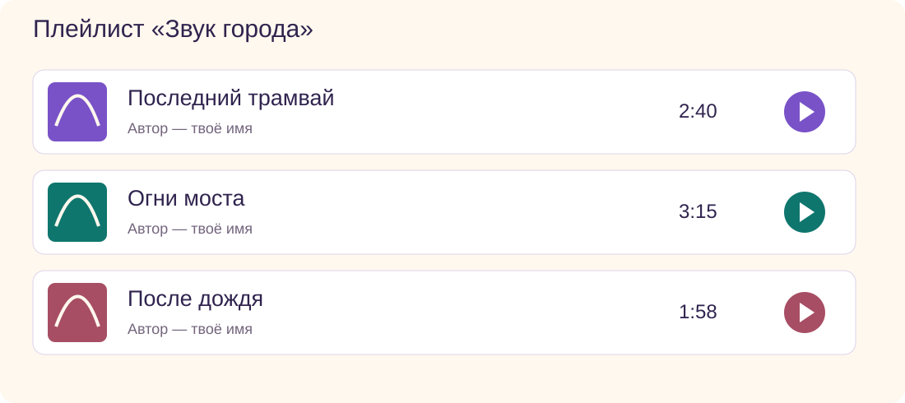
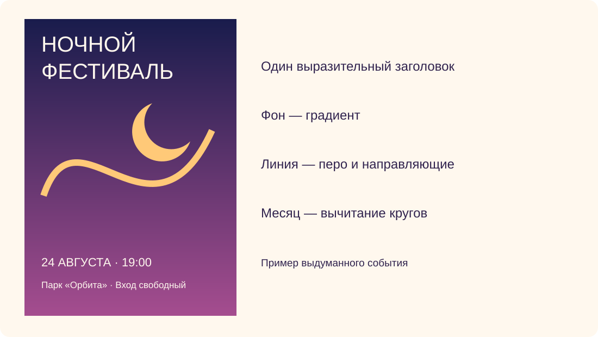
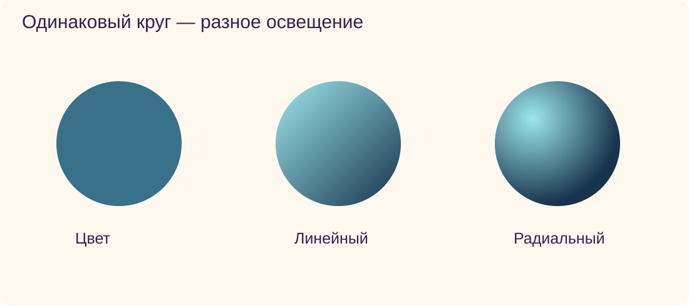

# Практика — музыка, афиша и свет

Три задания дают разные результаты. Сначала отработай компоненты, затем собери самостоятельную композицию и закончи коротким опытом с градиентом.

## Трафареты для самостоятельной тренировки

- [Карта и рубашка — лист A4](трафареты/трафарет-карта.svg).
- [Червы и бубны — точки и направляющие](трафареты/трафарет-масти.svg).
- [Пики ♠ — чёрная масть с ножкой](трафареты/трафарет-пики.svg).

Открой SVG в браузере для печати или перетащи в Figma как подложку. Заблокируй слой и рисуй поверх; перед экспортом скрой подложку. Это дополнительные упражнения к теории: основные задания практики остаются на другие темы.

## Задание 1 — Плейлист «Звук города»

Ты оформляешь список треков для музыкального приложения. Сделай три **горизонтальные строки 560 × 96 px**. Выбери настроение: прогулка по городу, путешествие в космос или музыка для игры.

### Что должно быть в строке

- Слева обложка 64 × 64, отступ от края 16 px.
- Рядом название трека, размер 20, и автор, размер 14.
- Справа время и кнопка воспроизведения из круга и треугольника.

Придумай названия сам. Например: «Последний трамвай», «Огни моста», «После дождя». Время — 2:40, 3:15, 1:58.

### Как выполнить

1. Собери одну строку, сохрани стиль названия и стиль цвета кнопки.
2. Преврати весь фрейм строки в главный компонент. Оставь его отдельно.
3. Из Assets вставь три экземпляра. В каждом измени название, автора и время.
4. Для обложки используй прямоугольник с заливкой Image. Меняй картинку через заливку существующего слоя; не добавляй новые слои в экземпляр. Можно взять собственные фотографии или нарисовать абстрактные обложки.
5. В главном компоненте увеличь круг кнопки с 32 до 36 px и отцентрируй треугольник. Проверь обновление всех строк и сохранность разных названий.

**Что сдать:** PNG списка и редактируемый файл с одним главным компонентом и тремя экземплярами. Покажи общее изменение кнопки.

**5–7 классы:** две строки, обложки из простых фигур. **9–11:** варианты строки «Обычная / Играет» с разным фоном; при переключении проверь сохранность названия и времени.

---

## Задание 2 — Афиша «Ночной фестиваль»

Теперь ты дизайнер мероприятия. Сделай **одну вертикальную афишу 600 × 840 px**: название, место, дата и крупный авторский знак. Плейлист из первого задания сюда переносить не нужно.

Выбери тему: фестиваль музыки, вечер настольных игр или выставка космических рисунков. Пример задаёт требования к читаемости, а не обязательное расположение деталей.

1. Залей **фон афиши** линейным градиентом из двух или трёх цветов. Сразу проверь, читается ли заголовок поверх него.
2. Нарисуй пером крупную волну, орбиту или звуковой след. Достаточно 3–5 точек с направляющими — это навык урока 2.
3. Из двух фигур собери знак через Union или Subtract — навык урока 1. Например, вычти меньший круг из большего и получи месяц. Сохрани исходные круги в стороне на случай переделки.
4. Примени стиль цвета к двум акцентным деталям. Измени сам стиль: обе детали должны обновиться.
5. Укажи выдуманные место и дату, добавь «Вход свободный». Посмотри на афишу при масштабе 25%: первым должно читаться название, затем дата.

**Что сдать:** PNG афиши, редактируемый файл и короткое объяснение, куда смотрит зритель первым. Здесь оцениваются композиция и сочетание навыков; создавать серию компонентов не требуется.

**Проще:** два цвета фона и одна плавная линия. **Сложнее:** подготовь ещё квадратную версию 600 × 600, заново расставив элементы без растягивания текста.

---

## Задание 3 — «Одна планета, три освещения» — 5 минут

Быстрый индивидуальный опыт. Создай три круга **120 × 120 px** и размести рядом. Это три версии одного предмета, а не три разных рисунка.

1. Первый круг: обычная сплошная заливка #39718A.
2. Второй: Linear от светлого #9DE7ED сверху-слева к тёмному #17334D снизу-справа.
3. Третий: Radial со светлым центром, смещённым вверх-влево, и тёмным краем. Потяни ручку радиуса, чтобы светлое пятно не занимало весь круг.
4. Подпиши «Цвет», «Линейный», «Радиальный». Выбери, какой круг больше похож на шар, и объясни почему.

**Что проверить:** во всех трёх случаях заливка назначена самому кругу. Ни форма, ни размер кругов не меняются — меняется только впечатление от света.

## Мини-галерея

Покажи одну работу и объясни конкретное решение: что обновляется через компонент, где применён общий стиль или как направление градиента меняет объём. Все три задания можно завершать по очереди; афиша подходит для самостоятельного продолжения после занятия.
