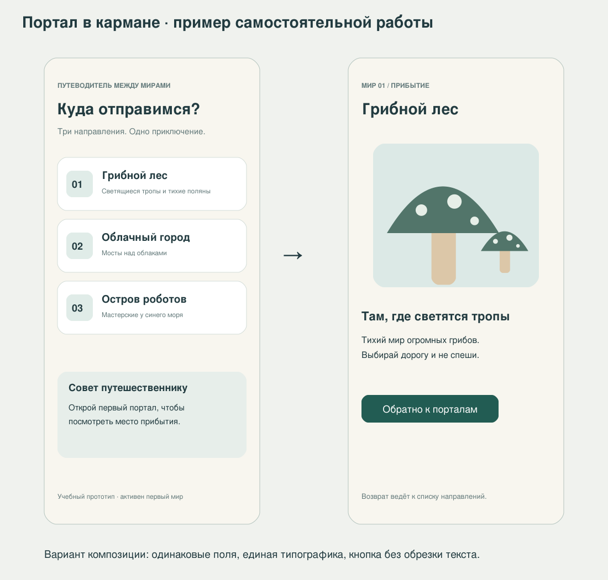
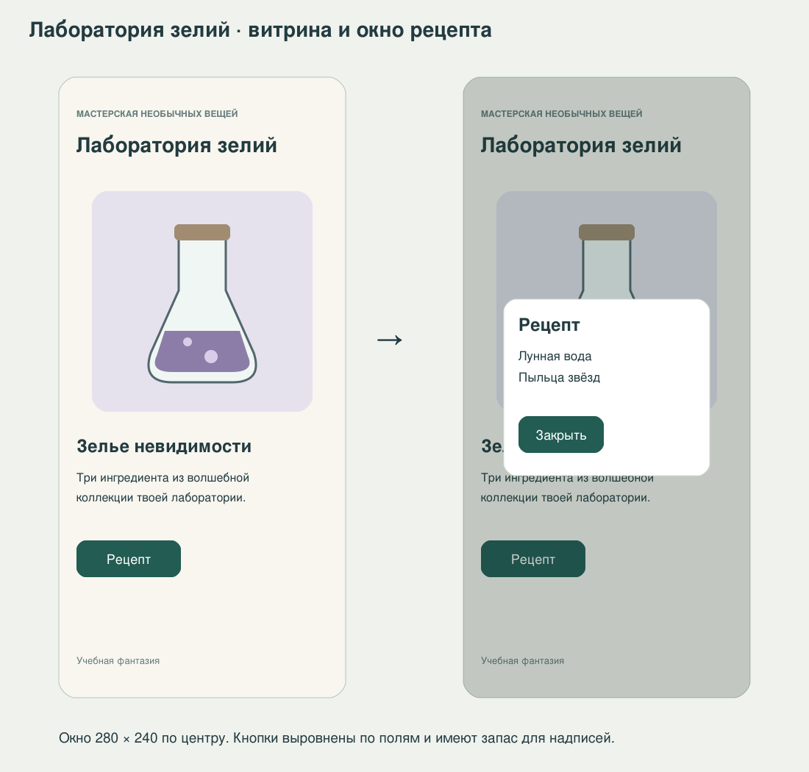

# Практика — интерфейсы необычных миров

**Рядом с работой:** [SVG-лист всех параметров для Figma](изображения/параметры-всех-элементов.svg)

Здесь три самостоятельные задачи. Первая переносит навык списка на новый сюжет, вторая соединяет прототип с авторской иллюстрацией, третья проверяет размеры за пять минут.

## 1. Новый вызов — «Портал в кармане»

Бюро закрыто на выходные. Ты создаёшь собственный путеводитель между мирами: выбор направления → экран прибытия → назад.

### Выбери вселенную

Пример: Грибной лес, Облачный город, Остров роботов. Можно придумать миры сладостей, подводные станции или острова с разной погодой. Рисунки и тексты должны отличаться от урока.

### Сначала разложи будущий маршрут

На черновике запиши: какой мир будет первым, как он называется и что зритель увидит после нажатия. Название в первой строке и на экране прибытия должно совпадать. Рядом подпиши действие кнопки возврата.

Создай отдельную страницу файла для практики либо новый Design file. Не удаляй готовое Бюро: оно пригодится как справочник по настройкам. Числа для этой задачи отличаются от урока, поэтому не переноси весь экран без проверки.

### Собери интерфейс

1. Создай два обычных фрейма 390 × 844, назови «Порталы» и «Прибытие».
2. На первом заголовок, пояснение и три строки-направления. Для строки используй **ширину 342, padding 16, gap 16**. Слева рисунок 48 × 48, справа вертикальный блок из названия и подсказки. Рисунку Fixed, текстовому блоку Fill, высоте строки Hug.
3. Одну строку преврати в компонент, экземпляры вставь из Assets. Собери вертикальный список с gap 16. У каждого направления своё название и подпись.
4. На экране прибытия сделай иллюстрацию **300 × 260**, название первого мира и кнопку «Обратно к порталам» на Hug.
5. Prototype: первая строка → Navigate to → Прибытие. Кнопка возврата → Navigate to → Порталы. Старт потока — Порталы.
6. Проверь длинное название: оно переносится и не закрывает рисунок. Добавь четвёртый экземпляр в список, покажи автоматическое изменение, затем оставь или удали его.

### Проверь перед сдачей

Открой Present с экрана «Порталы». Кликни первое направление, прочитай название на экране прибытия и вернись своей кнопкой. Потом в редакторе измени подпись строки на более длинную: высота должна подстроиться, рисунок — остаться 48 × 48. Это две разные проверки: поведение прототипа и поведение автолейаута.

Если другая строка тоже открывает первый мир, убери неверную связь или создай для неё собственный экран. Не оставляй переход с названием, не соответствующим содержимому.

**Что сдать:** два PNG, исходник и маршрут туда-обратно. В макете активен первый портал; старшие могут сделать отдельное прибытие для каждого.

**Проще:** два направления и рисунки из готовых фигур. **Сложнее:** у одного портала вариант «Закрыт», отличающийся цветом и подписью; не назначай ему переход.

---

## 2. Комбо — «Лаборатория зелий»

Теперь другой формат: **один экран и всплывающий рецепт**, без списка миров. Ты создаёшь витрину одного выдуманного зелья.

1. Создай экран 390 × 844 с названием лаборатории, крупной колбой, названием зелья и кнопкой «Рецепт».
2. Колбу нарисуй **пером**: узкое горлышко, расширяющийся корпус, замкнутый контур. Используй направляющие на округлых участках — навык урока 2.
3. Внутри добавь цветную жидкость. Чтобы она не выходила за колбу, сделай копию силуэта и примени Intersect с фигурой жидкости либо подстрой контур вручную. Исходную колбу с обводкой оставь сверху.
4. Заливка жидкости — линейный градиент двух близких оттенков из урока 3. На фоне обычный светлый цвет, чтобы контур читался.
5. Кнопка «Рецепт»: 18 px, padding 20 по горизонтали и 14 по вертикали, Hug. Под ней подпись «Учебная фантазия».
6. Окно «Рецепт» — 280 × 240: название и два-три **выдуманных** ингредиента, например «Лунная вода», «Пыльца звёзд», «Капля радуги». Это фантазийный интерфейс, не инструкция по смешиванию веществ.
7. Кнопка Рецепт → Open overlay → Рецепт, Center. Кнопка Закрыть внутри окна → Close overlay.
8. Проверь: после закрытия остаёшься на витрине, а не переходишь на другой экран.

### Проверь окно рецепта

Начни просмотр с витрины. Нажми «Рецепт»: витрина должна остаться под окном. Затем нажми «Закрыть»: окно исчезнет, сама витрина останется. Если вместо окна открывается новая страница, вернись к кнопке и выбери Open overlay. Если после закрытия открылся другой экран, замени её действие на Close overlay.

**Сдать:** PNG витрины и окна, редактируемый рисунок колбы и работающий прототип. **Сложнее:** два варианта кнопки «Обычная / Наведение» с Change to; проверить на компьютере.

---

## 3. Челлендж — «Сигнал из космоса»

На пульте пришельцев три команды: «Да», «Отправить сигнал», «Связаться с далёкой галактикой».

1. Сделай три отдельные кнопки: текст 18/22, padding 16 по бокам и 12 сверху/снизу, радиус 12. У каждой W/H Hug.
2. Размести их в вертикальном Auto layout с gap 12.
3. Замени вторую команду на ещё более длинную. Не меняй фон вручную — покажи, как контейнер подстроился.
4. Подпиши, что отвечает за размер кнопки, промежуток между кнопками и расстояние от букв до края.

**Результат:** три длины команды при одинаковых отступах. Дополнительные экраны и рисунки не нужны.

## Мини-галерея

Покажи одну автоматическую перестройку и один рабочий переход. Другой ученик называет ожидаемую реакцию до нажатия, затем автор проверяет её. Ничего исправлять в чужом файле не требуется.

Полная практика — на второй паре или самостоятельно после урока. Сначала закончи один проект с проверкой, затем переходи к следующему.
