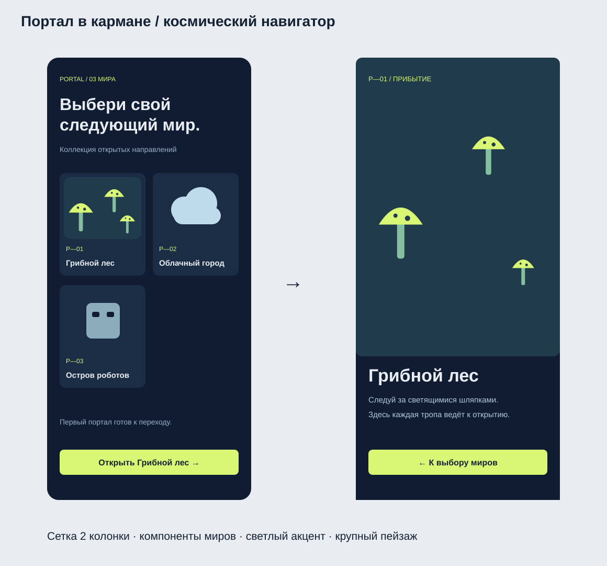
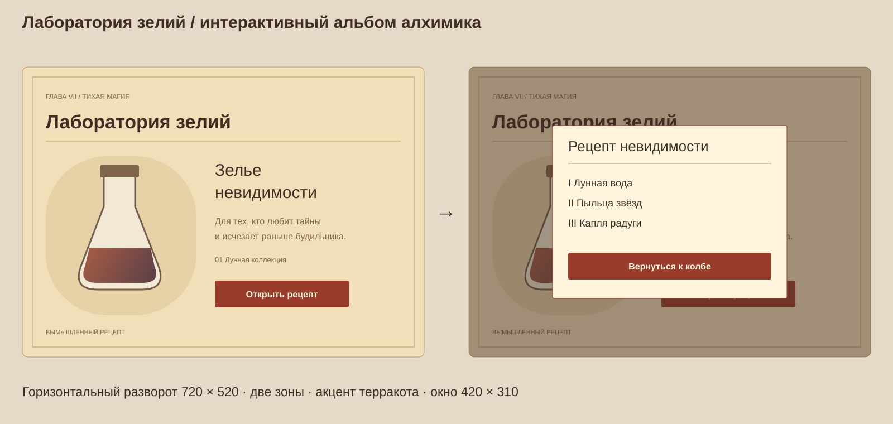

# Практика — интерфейсы необычных миров

**Рядом с работой:** [SVG-лист всех параметров для Figma](изображения/параметры-всех-элементов.svg)

Здесь три самостоятельные задачи. Первая переносит навык списка на новый сюжет, вторая соединяет прототип с авторской иллюстрацией, третья проверяет размеры за пять минут.

## 1. Новый вызов — «Портал в кармане»

Бюро закрыто на выходные. Ты создаёшь собственный путеводитель между мирами: выбор направления → экран прибытия → назад.

### Выбери вселенную

Пример: Грибной лес, Облачный город, Остров роботов. Можно придумать миры сладостей, подводные станции или острова с разной погодой. Рисунки и тексты должны отличаться от урока.

### Сначала разложи будущий маршрут

На черновике запиши: какой мир будет первым, как он называется и что зритель увидит после нажатия. Название в первой строке и на экране прибытия должно совпадать. Рядом подпиши действие кнопки возврата.

Создай отдельную страницу файла для практики либо новый Design file. Не удаляй готовое Бюро: оно пригодится как справочник по настройкам. Числа для этой задачи отличаются от урока, поэтому не переноси весь экран без проверки.

### Свой визуальный язык

Сделай тёмный навигатор: фон #101C32, поверхности #1B2D45, светлый текст #E9EDF2, вторичные подписи #9BAEC4, кнопки #D9F674 с текстом #142234. Для названий Segoe UI Semibold, для кодов миров Consolas. Главный экран — **сетка направлений**, а экран прибытия — **большой пейзаж и нижний блок действий**.

Использовать экран Бюро как основу с заменёнными подписями нельзя: здесь другая композиция. Учебный лист параметров Бюро помогает вспомнить настройки, но его цвета и расположения к практике не относятся.

### Собери интерфейс

1. Создай два фрейма 390 × 844 — «Порталы» и «Прибытие». У обоих фон #101C32.
2. На Порталах поставь заголовок в две строки: X24 Y72, размер32/39 Semibold. Выше маленькая подпись «PORTAL / 03 МИРА», Consolas12. Под заголовком короткое пояснение размер14.
3. Сделай **плитку мира 164 × 196**: фон #1B2D45, радиус12. Внутри рисунок 148 × 118 с отступом8, ниже код мира Consolas12 и название Segoe UI Semibold15. Создай компонент плитки.
4. Вставь три экземпляра с разными рисунками, кодами и названиями. Два первых объедини в горизонтальный Auto layout, gap14, padding0. Третий помести в следующую строку. Обе строки объедини в вертикальный Auto layout с gap18. Получится сетка шириной342; X24 Y220. Высота плитки Fixed, ширина текста ограничена плиткой — длинное название должно помещаться в выделенную область или потребует увеличения плиток всей серии.
5. Внизу X24 Y748 поставь кнопку W342 H48, радиус8, текст16 Semibold: «Открыть Грибной лес →». Фон #D9F674, текст #142234. Подпись не должна касаться краёв: минимум16 по бокам.
6. На Прибытии создай **пейзаж на всю ширину390**, высота570, в верхней части экрана. В нижнем блоке — название мира32–34, две короткие строки описания15 и кнопка «← К выбору миров» с такими же параметрами, X24 Y748.
7. В Prototype назначь **первой плитке и нижней кнопке** Navigate to → Прибытие. На Прибытии кнопке возврата — Navigate to → Порталы. Другие миры пока не имеют переходов; для них можно сделать собственные экраны дополнительно.
8. Для проверки Auto layout продублируй третью плитку **внутри второй горизонтальной строки**: рядом появится четвёртый мир с тем же gap. Верни исходные три плитки или оставь четвёртую с собственным содержимым.

### Проверь перед сдачей

Открой Present с экрана «Порталы». Кликни первую плитку либо кнопку открытия, прочитай название на экране прибытия и вернись своей кнопкой. Потом в редакторе добавь четвёртую плитку во вторую строку сетки: промежуток должен сохраниться, размеры плиток — остаться прежними. Это две разные проверки: поведение прототипа и поведение автолейаута.

Если другая плитка тоже открывает первый мир, убери неверную связь или создай для неё собственный экран. Не оставляй переход с названием, не соответствующим содержимому.

**Что сдать:** два PNG, исходник и маршрут туда-обратно. В макете активен первый портал; старшие могут сделать отдельное прибытие для каждого.

**Проще:** два направления и рисунки из готовых фигур. **Сложнее:** у одного портала вариант «Закрыт», отличающийся цветом и подписью; не назначай ему переход.

---

## 2. Комбо — «Лаборатория зелий»

Теперь другой формат: **один экран и всплывающий рецепт**, без списка миров. Ты создаёшь витрину одного выдуманного зелья.

### Стиль старой книги

Здесь меняем и формат, и композицию. Фрейм **720 × 520**, фон #F1DFBA, основной текст #3F2D24, линии #B99B68, акцент #9A3C2B. Заголовки Georgia, обычный текст Segoe UI. У кнопок радиус3; тёмно-зелёные округлые плашки из Бюро не используем.

1. Создай один фрейм «Лаборатория» 720 × 520. Внутри тонкая рамка: X18 Y18 W684 H484, без Fill, Stroke #B99B68 1. Сверху мелкая подпись главы и крупное название Georgia34, X42 Y75. Под заголовком линия по ширине636 на Y133.
2. Раздели композицию на две зоны. Слева область рисунка X42 Y160 W270 H285. Справа текст начинается X345: название зелья Georgia30, две строки; описание16; подпись коллекции Consolas13.
3. Нарисуй колбу пером: узкое горлышко, округлый замкнутый корпус. Обводка #705E4B 3. Внутри жидкость с градиентом #A65D45 → #573D49. Сделай копию силуэта для Intersect с жидкостью; исходную обводку оставь сверху. Это комбо пера и операций с контурами.
4. Справа поставь кнопку «Открыть рецепт»: X345 Y383 W240 H48, Fill #9A3C2B, радиус3, светлый текст #FFF5DD размер16 Semibold по центру. Здесь ширина **Fixed** — в отличие от Hug-кнопки урока. Проверь, что надпись помещается с полями минимум20.
5. Рядом на холсте создай отдельный фрейм «Рецепт» **420 × 310**, Fill #FFF5DD, Stroke #9A3C2B 1, радиус3. Заголовок Georgia26: X28 Y24. Под ним линия, затем три выдуманных ингредиента Segoe UI18: «Лунная вода», «Пыльца звёзд», «Капля радуги». Поля28, промежутки16.
6. Внизу окна кнопка «Вернуться к колбе»: X28 Y228 W364 H48, оформление как у основной кнопки. Open overlay → Рецепт, Center; закрывающей кнопке — Close overlay. За окном фон #3F2D24 с непрозрачностью45%.
7. После закрытия должно остаться то же книжное оформление с колбой. Для рецепта нового экранного разворота не создаём.

Все ингредиенты вымышленные; это оформление фантазийного справочника.

### Проверь окно рецепта

Начни просмотр с витрины. Нажми «Открыть рецепт»: витрина должна остаться под окном. Затем нажми «Вернуться к колбе»: окно исчезнет, сама витрина останется. Если вместо окна открывается новая страница, вернись к кнопке и выбери Open overlay. Если после закрытия открылся другой экран, замени её действие на Close overlay.

**Сдать:** PNG витрины и окна, редактируемый рисунок колбы и работающий прототип. **Сложнее:** два варианта кнопки «Обычная / Наведение» с Change to; проверить на компьютере.

---

## 3. Челлендж — «Сигнал из космоса»

На пульте пришельцев три команды: «Да», «Отправить сигнал», «Связаться с далёкой галактикой».

1. Сделай три отдельные кнопки: текст 18/22, padding 16 по бокам и 12 сверху/снизу, радиус 12. У каждой W/H Hug.
2. Размести их в вертикальном Auto layout с gap 12.
3. Замени вторую команду на ещё более длинную. Не меняй фон вручную — покажи, как контейнер подстроился.
4. Подпиши, что отвечает за размер кнопки, промежуток между кнопками и расстояние от букв до края.

**Результат:** три длины команды при одинаковых отступах. Дополнительные экраны и рисунки не нужны.

## Мини-галерея

Покажи одну автоматическую перестройку и один рабочий переход. Другой ученик называет ожидаемую реакцию до нажатия, затем автор проверяет её. Ничего исправлять в чужом файле не требуется.

Полная практика — на второй паре или самостоятельно после урока. Сначала закончи один проект с проверкой, затем переходи к следующему.
