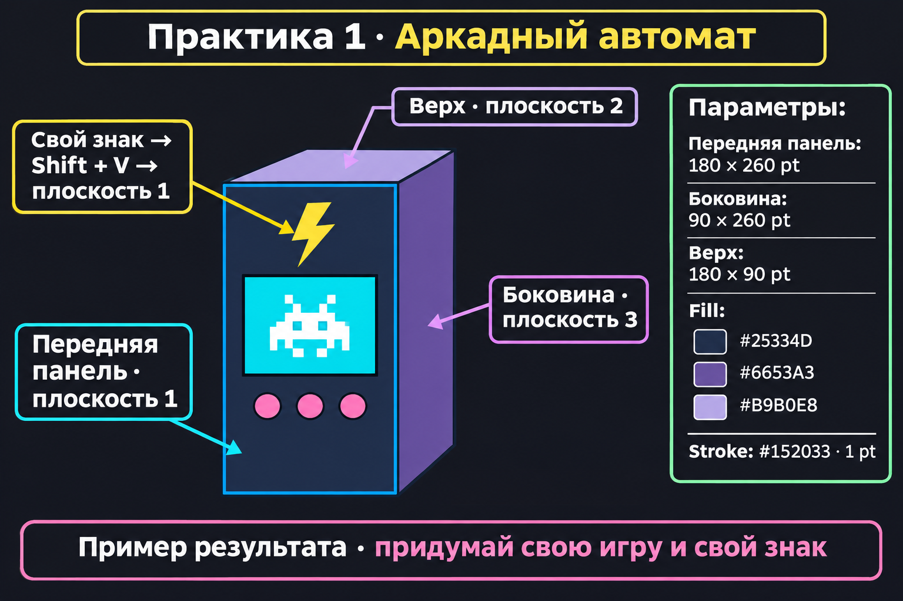
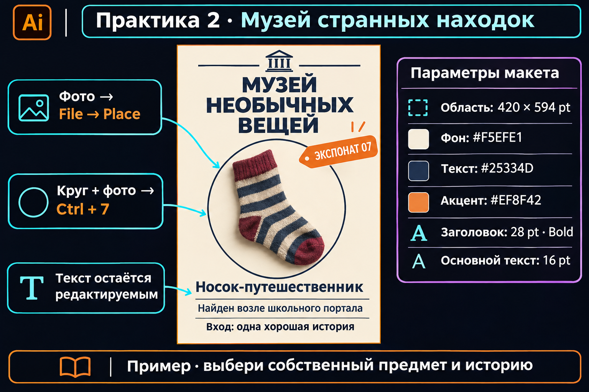
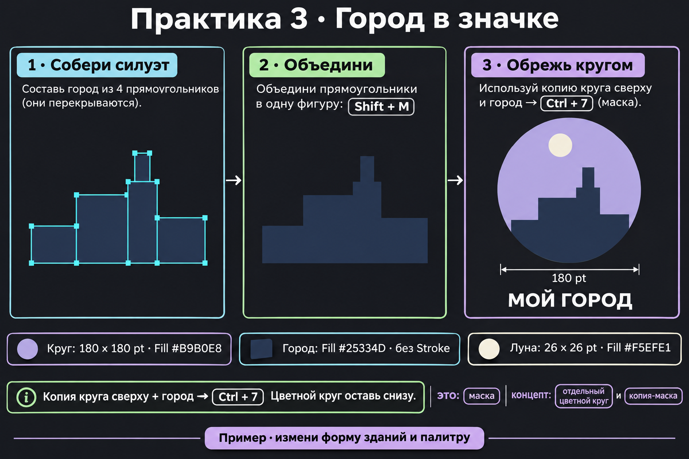

# Практика — аркада, музей и город в значке

Сегодня ты работаешь как автор: используешь приёмы урока, но придумываешь другой сюжет. Изображения ниже — примеры устройства работы. Форму значка, содержание экрана и историю экспоната придумай сам. Пиццу и помидор из теории повторять не нужно.

Практику можно разделить на несколько занятий. Сначала выполни одно задание целиком и проверь файл, затем переходи к следующему. Для всех работ сохраняй AI и PNG нужной монтажной области.

## 1. Новый вызов — аркадный автомат

В игровом клубе появился автомат с твоей собственной игрой. Нужно оформить его переднюю панель: сделать экран, кнопки и знак игры, затем перенести всё оформление на **вертикальную** плоскость. Это отличается от пиццы: теперь работаем с плоскостью 1.

### Параметры — настрой до оформления

- Документ: **600 × 600 pt**, цветовой режим **RGB**.
- Передняя панель: **180 × 260 pt**, плоскость **1**, Fill **#25334D**.
- Боковина: **90 × 260 pt**, плоскость **3**, Fill **#6653A3**.
- Верх: **180 × 90 pt**, плоскость **2**, Fill **#B9B0E8**; дополнительная часть.
- Обводка корпуса: **#152033**, толщина **1 pt**.
- Плоская заготовка оформления: **140 × 210 pt**; без заливки и обводки, только как временная граница.
- Экран: **120 × 100 pt**, Fill **#45C6D9**, Stroke **нет**.
- Кнопки: **20 × 20 pt**, Fill **#F06A9B**, Stroke **нет**.
- Знак игры: примерно **40 × 40 pt**, Fill **#F6D35A**, Stroke **нет**.

### Шаг 1. Подготовь документ и корпус

1. Выбери **Файл → Создать (File → New)**. Укажи размеры документа из списка и проверь единицы. В дополнительных параметрах выбери RGB, нажми «Создать». Сразу сохрани **Моя-аркада.ai**.
2. Открой **Окно → Слои**. Назови первый слой **Корпус**. Включи **Просмотр → Сетка перспективы → Двухточечная перспектива → Обычный вид**. Не двигай точки схода после создания корпуса.
3. На виджете плоскостей выбери левую грань — плоскость 1. Нажми M и один раз щёлкни по её сетке. В диалоге Rectangle введи ширину и высоту передней панели из списка. Появится вытянутый четырёхугольник, уходящий к левой точке схода.
4. Открой Fill и Stroke в панели инструментов. Назначь передней панели заливку и обводку корпуса из списка. В Properties → Appearance введи толщину обводки. В Layers переименуй фигуру в **Передняя панель**.
5. Переключи виджет на плоскость 3. Тем же способом создай боковину по её параметрам. Назначь её цвет. Инструментом Shift+V на этой плоскости подведи её левое ребро к общему вертикальному ребру передней панели. Приблизь масштаб: между гранями не должно быть щели.
6. Для первого уровня достаточно этих двух граней. Верх можно добавить после оформления: он не должен задерживать главный перенос.

### Шаг 2. Нарисуй оформление отдельно

1. Скрой сетку через меню «Просмотр». Создай новый слой **Оформление**. На свободном сером поле рядом с монтажной областью нарисуй временный прямоугольник заготовки. Он нужен, чтобы экран и кнопки точно поместились на передней панели.
2. Инструментом M через одиночный щелчок создай экран по списку параметров. Назначь заливку, отключи обводку. Нажми V и положи экран внутри заготовки, оставив место для знака сверху и кнопок снизу.
3. Для кнопки выбери **Эллипс / Ellipse**, клавиша L. Один раз щёлкни, введи одинаковые ширину и высоту кнопки, назначь её цвет. Нажми V и перетащи копию с Alt: получится вторая кнопка. Между кнопками оставь заметный промежуток.
4. Знак своей игры нарисуй из двух-трёх фигур: например, молнию пером или планету из круга и кольца. Не используй готовый символ из шрифта. Выдели детали знака и сгруппируй Ctrl+G.
5. В Layers выбери экран, обе кнопки и знак. Временный прямоугольник в выделение не включай. Нажми Ctrl+G и назови группу **Панель игры**. Временный прямоугольник удали. Сохрани плоскую копию группы на свободном поле.

### Шаг 3. Перенеси оформление на переднюю панель

1. Включи сетку. Выбери **Shift+V** и на виджете активируй **плоскость 1**. Перед переносом ещё раз посмотри на подсвеченную грань: горизонтальная плоскость из теории здесь не подходит.
2. В Layers выбери рабочую копию **Панели игры** целиком. Возьми её за середину рисунка и перетащи на переднюю панель автомата. Экран, кнопки и знак должны вместе принять её наклон.
3. Если оформление слишком большое, уменьши всю группу угловой ручкой инструментом Shift+V. Оставь поля по краям корпуса. Если группа скрылась за корпусом, выбери **Объект → Упорядочить → На передний план**.
4. Скрой сетку и проверь: оформление лежит на вертикальной грани, кнопки не остались на плоском исходнике. Если наклона нет, отмени перенос и проверь инструмент; если оформление легло на пол, выбери плоскость 1.

### Дополнительная часть — верх корпуса

Верх должен находиться на высоте автомата, а не у его основания. Поэтому одного переключения на горизонтальную грань недостаточно.

1. Дважды щёлкни инструмент **Сетка перспективы**. В его настройках включи автоматическое позиционирование по опорным точкам перспективных объектов (**Anchor Point of Perspective Artwork**) и пересечениям сетки (**Intersection of Gridlines**). Подтверди OK.
2. Выбери M, активируй плоскость 2. Удерживая Shift, наведи курсор на верхнюю общую вершину двух готовых граней: горизонтальная плоскость должна определиться на этой высоте.
3. Создай верх по параметрам и состыкуй его рёбра с верхними рёбрами корпуса. Если плоскость осталась у основания, отмени эту грань и попроси преподавателя вместе проверить привязку высоты. Не поднимай верх обычной стрелкой, пытаясь замаскировать неверную проекцию.

**Проверка:** плоская группа сохранена отдельно; рабочая группа перенесена на плоскость 1; весь экран и обе кнопки движутся вместе. Сдай AI и PNG автомата, объясни разницу с горизонтальным переносом пиццы.

---

## 2. Комбо — музей странных находок

Обычный предмет становится экспонатом, если придумать ему историю. Сделай афишу с собственной фотографией носка, ключа, карандаша или маленькой игрушки. Нужны фото в круглой маске, название и короткая подпись. Перспектива в этом задании не используется.

### Параметры — документ и оформление

- Монтажная область: **420 × 594 pt**, **RGB**.
- Фоновый прямоугольник: **420 × 594 pt**, Fill **#F5EFE1**, Stroke **нет**.
- Круглая область фотографии: **240 × 240 pt**; маскирующий контур сверху.
- Заголовок: **Arial Bold, 28 pt**, Fill **#25334D**, Stroke **нет**.
- Название экспоната и подпись: **Arial, 16 pt**, Fill **#25334D**, Stroke **нет**.
- Ярлык: **150 × 36 pt**, Fill **#EF8F42**, Stroke **нет**.
- Надпись ярлыка: **Arial Bold, 14 pt**, Fill **#25334D**, Stroke **нет**.
- Поля от края: минимум **24 pt**.

### Шаг 1. Подготовь фон и фотографию

1. Создай новый документ по параметрам и сохрани **Мой-музей.ai**. В Layers назови первый слой **Фон**. Инструментом M создай фоновый прямоугольник, назначь его цвет и отключи Stroke.
2. Чтобы фон точно совпал с областью, открой **Окно → Выравнивание (Align)**. Внизу панели выбери **Выровнять по монтажной области (Align to Artboard)**. Нажми выравнивание по центру по горизонтали и вертикали. Затем заблокируй слой Фон в Layers.
3. Создай слой **Экспонат**. Скопируй свою фотографию в рабочую папку. Выбери **Файл → Поместить**, укажи фото, включи Link и нажми «Поместить». Один раз щёлкни в середине страницы.
4. Обычной стрелкой V уменьши фотографию пропорционально за угловую ручку с Shift. Она должна полностью перекрывать будущий круг по ширине и высоте. Нельзя растягивать предмет за боковую ручку: носок или ключ должен сохранить форму.

### Шаг 2. Сделай круглое окно

1. Нажми L, один раз щёлкни на странице и введи параметры круга. Поставь его поверх фотографии так, чтобы важная часть предмета оказалась внутри. Временная заливка круга сейчас может закрывать фото — это нормально.
2. Если нужно поправить кадрирование, перемести круг V. Не нажимай Ctrl+7, пока не убедишься, что круг находится **выше фотографии** в Layers.
3. В Layers выбери круг, затем с Shift добавь фотографию. Фон и текст не выделяй. Нажми **Ctrl+7**. Всё снаружи круга скроется; исходное фото останется внутри обтравочной группы.
4. Чтобы изменить кадр, раскрой обтравочную группу в Layers и выбери строку фотографии. Сдвинь именно фото, сохранив круг на месте. Выйди Esc. Не разгруппировывай маску ради перемещения снимка.

### Шаг 3. Расскажи историю и проверь связь

1. Инструментом T создай заголовок над кругом. Через панель **Символ / Character** назначь шрифт, размер и цвет из списка. Если название длинное, сделай два коротких текстовых объекта, оставив поля страницы.
2. Под кругом добавь название находки и одну-две строки истории. Например: что это за предмет и где он якобы найден. Не копируй текст изображения: придумай собственную музейную легенду.
3. Нарисуй ярлык инструментом M по параметрам. Поставь рядом с кругом, но не на главной части предмета. Создай отдельным текстом номер экспоната, например «ЭКСПОНАТ 07», и размести поверх ярлыка. Выдели эти два объекта и сгруппируй.
4. Открой **Окно → Связи**. Выбери свою фотографию и покажи её статус. Сохрани вариант со связью, затем выполни **Встроить изображение / Embed** и сохрани копию **Мой-музей-встроенный.ai**. Исходное фото не удаляй.
5. Экспортируй только область афиши в PNG. Открой результат отдельно: круг не обрезан, буквы читаются, фото на месте.

**Проверка:** фотография помещена через Place; круг является маской; текст можно редактировать; ты можешь объяснить, какой внешний файл нужен варианту со связью.

---

## 3. Индивидуальный челлендж — город в значке

Создай маленький значок своего воображаемого города. Здесь важны объединение силуэта и аккуратная круглая граница. Не бери готовый город из city.ai: придумай собственные здания.

### Параметры — заготовка значка

- Документ: **360 × 360 pt**, **RGB**.
- Круг: **180 × 180 pt**, Fill **#B9B0E8**, Stroke **нет**.
- Здания: ширина **25–45 pt**, высота **40–110 pt**, Fill **#25334D**, Stroke **нет**.
- Луна: **26 × 26 pt**, Fill **#F5EFE1**, Stroke **нет**.
- Подпись: **Arial Bold, 18 pt**, Fill **#25334D**, Stroke **нет**.

### Шаг 1. Построй свой силуэт

1. Создай и сохрани документ **Мой-город.ai**. Инструментом L сделай круг по параметрам. Поставь его в середине области; он будет цветным фоном значка.
2. На свободном поле нарисуй инструментом M четыре-пять прямоугольников разной высоты. Назначь им общий тёмный цвет. Каждое соседнее здание должно немного пересекаться с другим: Shape Builder соединяет соприкасающиеся области, а не заполняет пустой промежуток.
3. Выдели только здания, нажми **Shift+M**. Протяни по участкам, которые должны стать одним силуэтом. Сними выделение и выбери результат V: проверь, что здания перемещаются вместе. Если остались отдельные части, повтори объединение нужных пересечений.

### Шаг 2. Ограничь город кругом

1. Перетащи силуэт в нижнюю половину цветного круга. Края зданий могут выходить за круг: их скроет маска. Луну нарисуй отдельно и положи внутри верхней части круга.
2. Выбери **цветной круг** в Layers. Нажми **Ctrl+C → Ctrl+F**. Переименуй копию в **Маска города** и подними на передний план. Исходный цветной круг должен остаться отдельным объектом снизу.
3. Выдели только **Маску города** и силуэт зданий. Нажми **Ctrl+7**. Выступающие края исчезнут, а цветной круг под городом сохранится. Если исчез цвет фона, отмени действие и проверь, осталась ли отдельная цветная копия круга.
4. Создай T подпись под значком и назначь её параметры. Она не должна входить в обтравочную маску. Сохрани AI и экспортируй PNG.

**Проверка:** свой силуэт построен из пересекающихся фигур; у города общая граница; маска и цветной круг — разные объекты. Покажи в Layers, где находится каждый из них.

## Как выбрать уровень

Для первого самостоятельного опыта выполни переднюю панель автомата и перенос оформления. Следующим шагом сделай музейную афишу. Верх корпуса и значок — продолжение для тех, кто уверенно выбирает объекты и понимает маску. Не нужно выполнять все три работы за оставшиеся десять минут.
